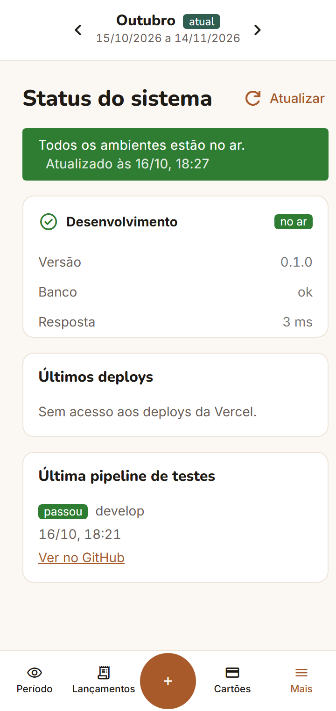
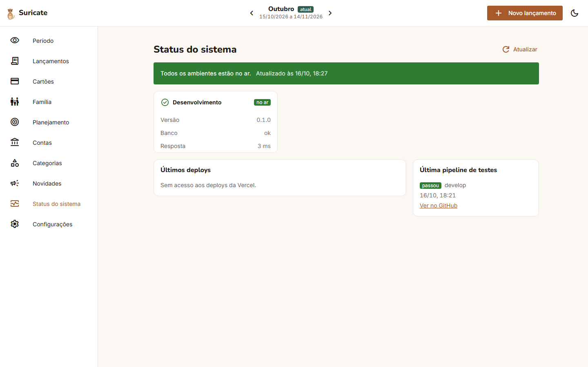
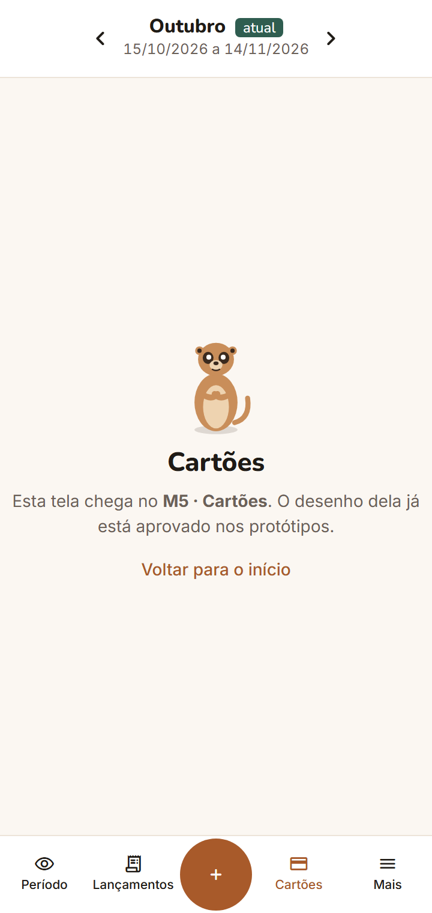
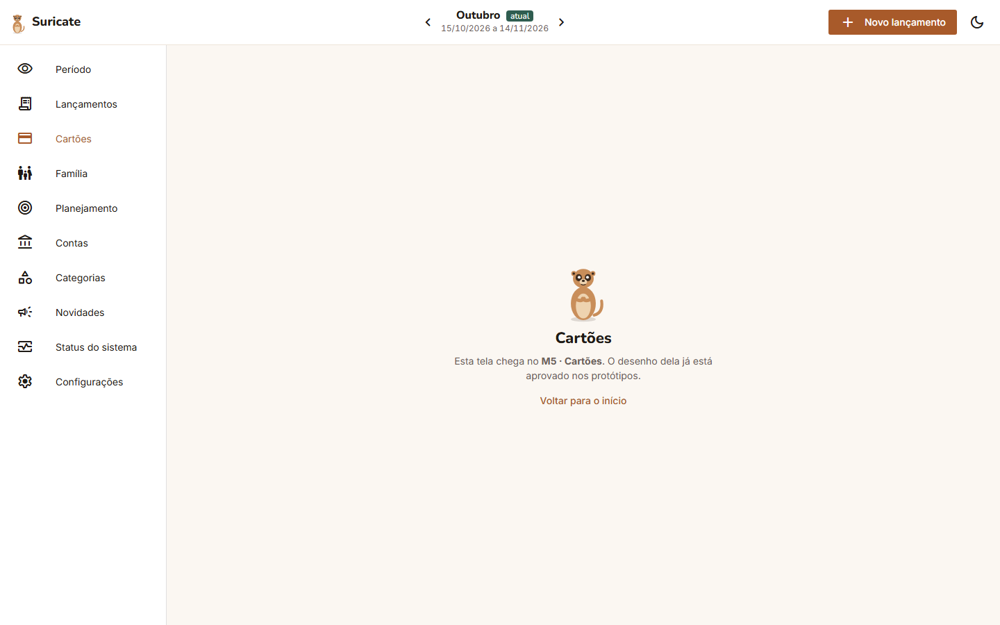
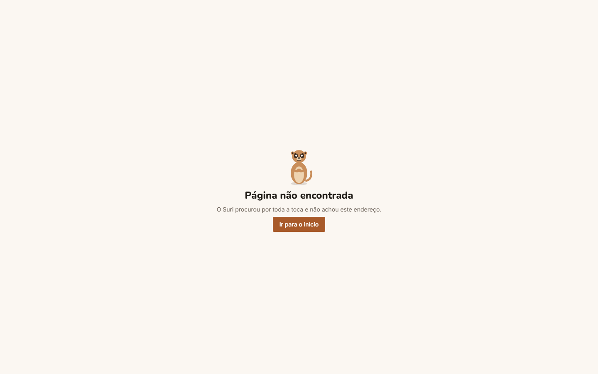

# M1 · Relatório de testes

Etapa 3 do M1 (issue #9). Mostra quais casos de teste previstos na [documentação técnica](tecnico.md#11-casos-de-teste-previstos) estão cobertos, onde cada um roda e o que deu. No fim há um roteiro curto para o Phelipe validar à mão.

Data: 16/10/2026 · Versão testada: 0.1.0 · Ramo: `develop` (`75ea0e0`) + os testes deste PR

## 1. Resumo

| Camada | Ferramenta | Onde roda | Testes | Resultado |
| --- | --- | --- | --- | --- |
| API e banco | pytest | pipeline (Postgres 16) e máquina local (SQLite) | 12 | ✅ 12 passaram |
| Front | Vitest + Vue Test Utils | pipeline e máquina local | 14 | ✅ 14 passaram |
| Build PWA | `npm run verificar:pwa` | pipeline, depois do build | 1 verificação | ✅ ok |
| Ponta a ponta | Playwright, 360 px e 1440 px | pipeline (cada deploy da Vercel) e máquina local | 5 × 2 telas | ✅ 10 passaram no preview deste PR |
| Ambientes | Actions *Migrações* e *Pré-produção* | GitHub Actions + Neon | 4 execuções | ✅ todas passaram |

Todos os 17 casos previstos têm teste automático. CT09 (tema escuro) e CT12 (banco de cada ambiente) também têm um passo no [roteiro manual](#5-roteiro-de-validação-manual), porque o teste automático confere o efeito indireto: a classe do tema e o ambiente informado pela API.

## 2. Casos de teste

| # | Caso | Teste automático | Resultado |
| --- | --- | --- | --- |
| CT01 | `/api/health` com banco disponível | `backend/tests/test_health.py::test_ct01_banco_disponivel` | ✅ |
| CT02 | `/api/health` com banco indisponível ou sem configuração | `test_health.py::test_ct02_banco_indisponivel`, `test_ct02_banco_nao_configurado` | ✅ |
| CT03 | `APP_ENV` e `APP_VERSION` na resposta | `test_health.py::test_ct03_ambiente_e_versao_vem_das_variaveis` | ✅ |
| CT04 | `/api/docs` some em produção | `test_health.py::test_ct04_documentacao_fora_da_producao`, `test_ct04_documentacao_escondida_em_producao` | ✅ |
| CT05 | Migrações sobem e descem | `test_migracoes.py::test_ct05_migracoes_sobem_e_descem` (Postgres 16 na pipeline) | ✅ |
| — | Seed do usuário 1 não duplica | `test_seed.py::test_seed_cria_o_usuario_1_uma_vez` | ✅ |
| CT06 | Página inicial mostra ambiente, versão e banco | `frontend/tests/app.test.js` · CT06 (3 testes: ok, 503, API fora) | ✅ |
| CT07 | Layout no celular | `app.test.js` · CT07 e CT08 (barra inferior, seletor de período, "em breve") | ✅ |
| CT08 | Layout no desktop | `app.test.js` · CT07 e CT08 (barra lateral, sem barra inferior) | ✅ |
| CT09 | Tema escuro | `app.test.js` · CT09 (troca a classe que troca os tokens) + roteiro manual | ✅ |
| CT10 | Build PWA gera manifesto e service worker | **novo:** `frontend/scripts/verificar-pwa.mjs` (manifesto com nome, cores e ícones; `sw.js` sem cache de `/api`) | ✅ |
| CT11 | Preview da Vercel, 360 px e 1440 px | `e2e/tests/fundacao.spec.js` (página inicial, navegação, status, 404) | ✅ 8/8 no deploy `develop` |
| CT12 | Preview de `feature/*` e `develop` usa o banco `dev` | **novo:** `fundacao.spec.js` · "o deploy usa o ambiente do seu ramo" + roteiro manual | ✅ preview de `feature/m1-testes` mostrou Desenvolvimento, banco ok |
| CT13 | `staging` usa o banco `staging`, copiado de `main` | Action *Pré-produção* (recria o ramo a partir de `main` e migra) + o mesmo teste novo do CT12, no primeiro deploy de `staging` | ✅ Action · ⏳ deploy na primeira release |
| CT14 | Status mostra os três ambientes; o que está fora fica vermelho | `test_status.py` (2 testes) + **novo:** `frontend/tests/status.test.js` (3 testes: vermelho, resumo verde, deploys e pipeline) | ✅ |
| CT15 | Status não expõe dados de usuários | `test_status.py::test_ct15_nao_expoe_dados_de_usuarios` | ✅ |
| CT16 | Novidades lista as versões do `CHANGELOG.md` | `novidades.test.js` · CT16 + conversor | ✅ |
| CT17 | Selo de versão nova some depois de abrir | `novidades.test.js` · CT17 | ✅ |

### Como o CT12 e o CT13 são conferidos

O evento de deploy da Vercel traz só o commit, não o ramo. A pipeline pergunta ao GitHub em qual ramo está aquele commit e passa o ambiente esperado ao Playwright (`E2E_AMBIENTE`):

| Deploy | Ambiente esperado | Banco (variável `DATABASE_URL` do mesmo escopo) |
| --- | --- | --- |
| Production (`main`) | Produção | ramo `main` do Neon |
| Preview do ramo `staging` | Pré-produção | ramo `staging` |
| Qualquer outro preview | Desenvolvimento | ramo `dev` |

`APP_ENV` e `DATABASE_URL` são configurados com o mesmo escopo na Vercel. Se a página mostra o ambiente certo com `banco: ok`, o deploy está com as variáveis daquele ambiente.

## 3. Execuções nos ambientes

| Data | O quê | Resultado |
| --- | --- | --- |
| 16/10 17:22 | *Migrações* em `development` (ramo `dev`), com seed | ✅ tabela `usuario` + "Usuário 1 criado" |
| 16/10 17:24 | *Migrações* em `staging` | ✅ |
| 16/10 17:29 | *Pré-produção*: recria `staging` a partir de `main` com a `NEON_API_KEY` e migra | ✅ |
| 16/10 18:14 | *Migrações* em `production` (rodada pelo Phelipe) | ✅ |
| 16/10 18:22 | e2e no deploy do `develop` (`suricatefinance-qetswtzrf…vercel.app`) | ✅ 8 passaram |
| 16/10 18:36 | e2e no preview deste PR (`feature/m1-testes`), com o teste novo do ambiente | ✅ 10 passaram |
| 16/10 18:22 | Página de status no preview do `develop` | ✅ Desenvolvimento no ar, banco ok, 238 ms; últimos deploys e pipeline aparecem |

## 4. Problemas encontrados e corrigidos

| # | Problema | Causa | Correção |
| --- | --- | --- | --- |
| P1 | e2e falhava com 8 erros mesmo com o app no ar | As Actions de migração usam ambientes do GitHub, que criam *deployments*; o e2e rodava contra o endereço da Action | PR #116: e2e só para endereços `*.vercel.app`, e a concorrência agrupa por deployment |
| P2 | e2e nunca rodava contra a Vercel | Os eventos `deployment_status` estavam desligados no projeto da Vercel | Ligados em Settings › Git (16/10) |
| P3 | Status: "Sem acesso aos deploys da Vercel" | Faltavam `VERCEL_API_TOKEN` e `VERCEL_PROJECT_ID`; `STATUS_AMBIENTES` só existia em Production | Variáveis criadas em Production e Preview (16/10) |
| P4 | 1ª string de conexão salva no GitHub não era uma URL | O valor colado veio com outro formato | Recolada pelo *Copy snippet* do Neon; a Action *Migrações* confirmou |
| P5 | `verificar-pwa.mjs` não achava o build no Windows | Caminho com espaço ("Phelipe Afonso") virava `%20` | Uso de `fileURLToPath` |
| P6 | Status: espaço vazio grande entre os cartões e "Últimos deploys" no desktop (achado na etapa 4, #10) | O contêiner `.column` do Quasar quebra linha e esticava a grade até a altura da tela; só aparecia com 3 ambientes | `no-wrap` nas páginas Status, Início e Novidades; o e2e da página de status passou a conferir a altura da grade |

### Pontos conhecidos (não são defeitos)

- **Produção e Pré-produção aparecem "fora do ar" na página de status.** Os ramos `main` e `staging` ainda não têm o código do app. Isso muda na primeira release. Os bancos já estão migrados.
- **"Produção · develop" em Últimos deploys.** É o primeiro deploy da Vercel, feito do `develop` na importação do projeto. A linha é substituída no primeiro deploy do `main`.

## 5. Roteiro de validação manual

São cerca de 10 minutos, no celular e no computador. Abra o preview do `develop`: `https://suricatefinance-git-develop-phafonsos-projects.vercel.app`. Ele pede login na Vercel, que é a proteção dos previews.

| # | Passo | Esperado | ✔ |
| --- | --- | --- | --- |
| M1 | Abra a página inicial no celular | Suri, "Saúde do sistema" com Ambiente **Desenvolvimento**, versão 0.1.0 e **banco: ok**; barra inferior com Período, Lançamentos, +, Cartões e Mais | ☐ |
| M2 | Mesma página no computador | Barra lateral à esquerda, seletor "Outubro · 15/10/2026 a 14/11/2026" no topo, botão "Novo lançamento" | ☐ |
| M3 | Toque na lua (computador) ou em Mais › **Usar tema escuro** (celular) | Tudo fica escuro, texto legível, botão continua terracota | ☐ |
| M4 | Abra **Status do sistema** | Desenvolvimento no ar; Produção e Pré-produção fora (esperado, ver acima); últimos deploys e pipeline aparecem | ☐ |
| M5 | Abra **Novidades** | "Ainda não há versão publicada" e a lista do que vem na próxima | ☐ |
| M6 | Toque em **Cartões** | Tela "em breve" dizendo que chega no M5 | ☐ |
| M7 | Digite um endereço inventado, ex. `/abc` | Suri bravo, "Página não encontrada", botão "Ir para o início" | ☐ |
| M8 | No celular, use *Adicionar à tela inicial* | Ícone do Suri, abre sem a barra do navegador | ☐ |
| M9 | No Neon, ramo `dev` › Tables › `usuario` | Uma linha: "Usuário 1" (fictício). No ramo `main`, a tabela está vazia | ☐ |

## 6. Capturas (máquina local, 16/10)

| Tela | Celular (360 px) | Desktop (1440 px) |
| --- | --- | --- |
| Início |  |  |
| Status |  |  |
| Novidades |  |  |
| Em breve |  |  |
| 404 |  |  |

Na máquina local, a página de status monitora só a própria API e não tem token da Vercel. Por isso mostra um ambiente e "Sem acesso aos deploys". Na Vercel aparecem os três ambientes.

Para gerar de novo: `cd e2e && E2E_BASE_URL=http://localhost:9001 node capturas.mjs ../docs/modulos/m1-fundacao/img /:inicio /status:status`

## 7. Proposta para depois do merge

A documentação técnica (seção 10) prevê transformar a pipeline em verificação obrigatória no `main` quando ela estiver estável. Proposta: exigir os jobs **api** e **front** no ruleset "Proteger main". O **e2e** roda depois do deploy, não no PR, então fica de fora. Só faço essa mudança com o seu ok.
