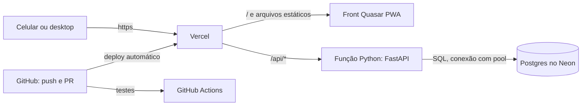
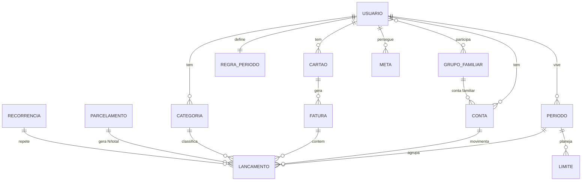
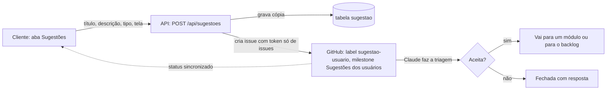

# M1 · Fundação: documentação técnica

O M1 entrega o esqueleto que roda nos três ambientes: o app Quasar com o layout dos protótipos, a API FastAPI com uma rota de saúde ligada ao banco, o Postgres no Neon com migrações, o deploy na Vercel e a pipeline de testes. Nenhuma funcionalidade de usuário entra aqui; elas começam no M2.

Referências: [Análise e Requisitos](https://claude.ai/code/artifact/383dc308-00c9-4c01-9659-85308904fd79) (RNF01–RNF10 e a seção de tecnologia), [processo de trabalho](../../processo.md) e [mapa de telas](../../prototipos/mapa-de-telas.md).

## 1. Escopo

| Entra no M1 | Fica para depois |
| --- | --- |
| Estrutura do repositório (front, back, testes, CI) | Login e cadastro (M2) |
| App Quasar em modo PWA, com tema, fontes e o layout de navegação dos protótipos | Telas de negócio (M2 em diante) |
| API FastAPI com `GET /api/health` | Endpoints de negócio |
| Postgres no Neon, SQLAlchemy e Alembic, com a primeira migração | Tabelas de cada módulo (criadas no módulo) |
| Deploy na Vercel com os três ambientes do Git Flow | Domínio próprio |
| Pipeline de testes no GitHub Actions (#94) | Testes de cada funcionalidade (no módulo) |

## 2. Arquitetura

Um único projeto na Vercel serve o front e a API, com um único domínio. O front é estático (PWA); a API é uma função Python sob `/api`.



- **Mesmo domínio para front e API:** sem CORS e com cookies de sessão simples no M2.
- **Conexão com o banco:** a string de conexão com pool do Neon (PgBouncer). Como cada requisição pode cair numa função nova, a API não guarda pool próprio (SQLAlchemy com `NullPool`).
- **Banco que dorme:** no plano grátis, o Neon suspende o banco sem uso, e a primeira requisição depois disso demora alguns segundos. É aceitável para o uso atual.

## 3. Estrutura do repositório

```
suricate_finance/
├── api/
│   └── index.py              # entrada da Vercel: só importa e expõe o app
├── backend/
│   ├── suricate/
│   │   ├── main.py           # cria o FastAPI e registra as rotas
│   │   ├── config.py         # configurações por variável de ambiente
│   │   ├── db.py             # engine e sessão do SQLAlchemy
│   │   ├── models/           # tabelas, uma por módulo
│   │   ├── routes/           # rotas, uma por módulo (health.py no M1)
│   │   └── services/         # regras de negócio puras, testáveis sem banco
│   ├── migrations/           # Alembic
│   ├── tests/                # pytest
│   └── alembic.ini
├── frontend/                 # projeto Quasar (Vite), modo PWA
│   ├── src/
│   │   ├── css/              # tokens do guia visual (claro e escuro)
│   │   ├── layouts/          # MainLayout: barra inferior no celular, lateral no desktop
│   │   ├── pages/            # uma página por tela (só a inicial no M1)
│   │   └── components/       # PeriodoSelector, Suri, etc.
│   └── tests/                # Vitest
├── e2e/                      # Playwright
├── prototipos/               # M0, só referência
├── docs/
├── .github/workflows/        # etapas.yml (já existe) e testes.yml (novo)
├── requirements.txt          # dependências da API, lidas pela Vercel
├── .python-version           # 3.13
└── vercel.json
```

O arquivo `api/index.py` é o único `.py` dentro de `api/`, porque a Vercel transforma cada arquivo dessa pasta numa função separada. O código fica em `backend/` e entra no pacote da função pela configuração `includeFiles` do `vercel.json`.

## 4. Tecnologias e versões

| Camada | Escolha | Versão (fixada na etapa 2) |
| --- | --- | --- |
| Front | Quasar com `@quasar/app-vite`, Vue 3, Pinia, Vue Router | Quasar 2.16.x, Vue 3.4.x |
| Ícones e fontes | Material Symbols Rounded, Nunito e Inter | Google Fonts |
| API | Python, FastAPI, Pydantic, pydantic-settings | Python 3.13, FastAPI 0.119.x |
| Banco | Postgres no Neon, SQLAlchemy 2, Alembic, psycopg 3 | Postgres 16 |
| Testes | pytest, Vitest + Vue Test Utils, Playwright | — |
| Qualidade | Ruff (Python), ESLint + Prettier (front) | — |
| Node | Node 22 LTS | — |

## 5. Ambientes

O plano grátis da Vercel tem só "Produção" e "Preview". A pré-produção vira um ramo fixo, `staging`, com variáveis de preview específicas desse ramo.

| Ambiente | Ramo do Git | Vercel | Banco no Neon | Dados |
| --- | --- | --- | --- | --- |
| Produção | `main` | Production, `suricate-finance.vercel.app` | ramo `main` | Reais |
| Pré-produção | `staging` | Preview com variáveis do ramo `staging` e endereço fixo | ramo `staging` | Cópia da produção, recriada a cada release |
| Desenvolvimento | `develop` e `feature/*` | Preview, um endereço por ramo | ramo `dev` | Fictícios (usuário 1 dos protótipos) |

**Como uma release passa pela pré-produção** (ajuste do Git Flow para o plano grátis):
1. `git flow release start 0.1.0` a partir de `develop`.
2. O ramo da release é enviado também como `staging` (`git push origin release/0.1.0:staging --force`).
3. Uma Action recria o ramo `staging` do Neon a partir de `main` (cópia instantânea dos dados reais) e roda as migrações.
4. A Vercel publica a pré-produção. O Phelipe valida.
5. `git flow release finish 0.1.0` leva a versão para `main` (produção) e `develop`.

Hotfix segue o mesmo caminho, a partir de `main`.

**Dados reais em pré-produção (RNF03, RNF04):** o endereço de `staging` fica protegido pela proteção de deploy da Vercel (só o dono da conta acessa). Quando houver outros usuários, a cópia passa a mascarar nomes e e-mails.

## 6. Variáveis de ambiente

| Variável | Uso | Onde fica |
| --- | --- | --- |
| `DATABASE_URL` | Conexão com pool do Neon | Vercel, uma por ambiente |
| `DATABASE_URL_DIRECT` | Conexão direta, só para as migrações | Vercel e GitHub (secrets) |
| `APP_ENV` | `production`, `staging` ou `development` | Vercel |
| `APP_VERSION` | Versão exibida na rota de saúde | Vercel (do commit) |
| `NEON_API_KEY`, `NEON_PROJECT_ID` | Recriar o ramo `staging` na Action | GitHub (secrets) |
| `VERCEL_AUTOMATION_BYPASS_SECRET` | Playwright acessar previews protegidos | GitHub (secrets) |
| `VERCEL_API_TOKEN`, `GITHUB_STATUS_TOKEN` | Página de status lê os últimos deploys e a última pipeline (só leitura) | Vercel |
| `GITHUB_SUGESTOES_TOKEN` | Aba Sugestões cria e lê issues (M2) | Vercel |

Nenhum segredo vai para o código. O `.gitignore` já ignora os arquivos `.env`.

## 7. Banco de dados

O M1 cria só a base: a tabela de usuários e o controle de migrações. Cada módulo cria as próprias tabelas na sua etapa de desenvolvimento, a partir do modelo abaixo, que é a visão de conjunto do MVP e será detalhada na documentação técnica de cada módulo.



| Tabela | Módulo | Observação |
| --- | --- | --- |
| `usuario` | M1 (base), M2 | Nome, e-mail, data de criação; senha e login Google no M2 |
| `onboarding_progresso` | M2 | Etapa atual e conquistas |
| `regra_periodo`, `periodo` | M3 | O período é gravado para poder ser ajustado quando o salário entra em outra data (RN04) |
| `conta`, `categoria`, `lancamento`, `recorrencia`, `parcelamento` | M4 | `parcelamento` guarda total e já pagas e gera as parcelas N/total (decisão do PR #98) |
| `cartao`, `fatura` | M5 | O lançamento de cartão guarda data da compra e fatura (RN08) |
| `grupo_familiar`, `participacao`, `repasse` | M6 | Percentual de cada um e status de repasse (RN13, RN14, RN26) |
| `limite` | M7 | Limite por categoria e por tipo (cartão, débito/Pix), com vigência |
| `meta` | Fase 2 | — |

**Convenções:** valores em `numeric(12,2)`; datas em `date` (sem fuso); todas as tabelas com `id` UUID, `usuario_id`, `criado_em` e `atualizado_em`; toda consulta filtra por `usuario_id` (RF02).

## 8. API do M1

| Método | Rota | Resposta |
| --- | --- | --- |
| `GET` | `/api/health` | `{"status": "ok", "ambiente": "development", "versao": "0.1.0", "banco": "ok"}`; com o banco fora, `503` e `"banco": "indisponível"` |

A documentação automática do FastAPI fica em `/api/docs`, só fora da produção.

## 9. Front do M1

- Projeto Quasar em modo PWA, com nome, ícones e cor de tema do Suricate.
- Tokens do guia visual aprovado no M0 (Terra, Savana, Areia; Nunito e Inter), nos temas claro e escuro.
- `MainLayout` igual ao dos protótipos: barra inferior com 5 destinos no celular, barra lateral no desktop e o seletor de período no topo (ainda com dados fixos).
- Uma página inicial que mostra o Suri e o resultado de `/api/health` (ambiente, versão e banco), para provar que front, API e banco estão ligados em cada ambiente.

## 10. Pipeline de testes (issue #94)

Arquivo novo `.github/workflows/testes.yml`, rodando em todo PR e em todo push para `develop`, `staging` e `main`:

| Job | O que faz |
| --- | --- |
| `api` | Ruff; pytest com um Postgres de serviço do GitHub; Alembic sobe e desce as migrações |
| `front` | ESLint; Vitest; build do Quasar em modo PWA |
| `e2e` | Espera o preview da Vercel ficar pronto e roda o Playwright em 360 px e 1440 px |

Depois que a pipeline estiver estável, os três jobs viram verificações obrigatórias no ruleset do `main`.

## 11. Casos de teste previstos

| # | Camada | Caso | Resultado esperado |
| --- | --- | --- | --- |
| CT01 | API | `GET /api/health` com banco disponível | 200, `status: ok`, `banco: ok` |
| CT02 | API | `GET /api/health` com banco indisponível | 503, `banco: indisponível` |
| CT03 | API | Configurações lidas do ambiente | `APP_ENV` e `APP_VERSION` refletidos na resposta |
| CT04 | API | `/api/docs` em produção | 404 |
| CT05 | Banco | Migração sobe e desce | `alembic upgrade head` e `downgrade base` sem erro |
| CT06 | Front | Página inicial | Mostra ambiente, versão e banco vindos da API |
| CT07 | Front | Layout no celular | Barra inferior com 5 destinos e seletor de período |
| CT08 | Front | Layout no desktop | Barra lateral e seletor de período |
| CT09 | Front | Tema escuro | Cores trocam pelos tokens do guia |
| CT10 | Front | Build PWA | Gera manifesto e service worker |
| CT11 | E2E | Preview da Vercel, 360 px e 1440 px | Página carrega e mostra `banco: ok` |
| CT12 | Ambientes | Preview de `feature/*` | Usa o banco `dev` |
| CT13 | Ambientes | Deploy de `staging` | Usa o banco `staging`, com dados copiados de `main` |
| CT14 | Status | Página de status | Mostra os três ambientes, com versão e banco; um ambiente fora aparece em vermelho |
| CT15 | Status | Página de status | Não expõe nenhum dado de usuário |
| CT16 | Novidades | Página Novidades | Mostra as versões do `CHANGELOG.md`, da mais nova para a mais antiga |
| CT17 | Novidades | Versão nova desde a última visita | Selo no item do menu, que some depois de abrir a página |

## 12. Tarefas da etapa 2

Viram sub-issues de "[M1] 2. Desenvolvimento" quando este documento for aprovado:

1. Estrutura do repositório, Ruff, ESLint e Prettier.
2. API FastAPI com configurações, banco e `GET /api/health`.
3. Alembic com a migração inicial (`usuario`).
4. Projeto Quasar PWA com tema, fontes, ícones e `MainLayout`.
5. Página inicial ligada à rota de saúde.
6. Projeto no Neon com os ramos `main`, `dev` e `staging`, e o seed do usuário 1 em `dev`.
7. Projeto na Vercel, `vercel.json`, variáveis por ambiente e proteção da pré-produção.
8. Action de pré-produção (recriar o ramo `staging` do Neon e migrar).
9. Pipeline de testes (#94).
10. Página de status dos ambientes e das entregas (seção 15).
11. Página Novidades lendo o `CHANGELOG.md`, com a entrada da versão 0.1.0 (seção 16).

## 13. O que preciso do Phelipe

- **Login na Vercel e no Neon com a conta do GitHub** (os dois gratuitos), na etapa 2. Eu conduzo o resto pelo navegador e pela linha de comando.
- **Uma chave da API do Neon** criada por você e guardada como secret do GitHub (eu indico onde).

## 14. Riscos

| Risco | Efeito | Como tratamos |
| --- | --- | --- |
| Plano Hobby da Vercel é só para uso não comercial | Ao cobrar (RN31), precisa de outro plano | Migrar para o Pro ou outra hospedagem antes de abrir para outras pessoas |
| Runtime Python da Vercel ainda marcado como Beta | Mudança de comportamento | Versões fixadas; teste de saúde em todo deploy |
| Banco do Neon suspende sem uso | Primeira requisição lenta | Aceito no uso atual; avaliar depois |
| Limite de ramos do Neon no plano grátis | Poucos ramos | Só três ramos fixos; previews de `feature/*` usam `dev` |
| Dados reais na pré-produção | Exposição de dados pessoais | Endereço protegido; mascaramento quando houver outros usuários |

## 15. Painel de gestão (pedido na revisão do PR #100)

Pedido: um dashboard completo para acompanhar o negócio (usuários de teste, assinantes, status de cada ambiente), de preferência hospedado na Vercel.

**Proposta: o painel é uma área do próprio Suricate, em `/admin`**, servida pela mesma Vercel e lendo o mesmo banco. O Grafana não roda na Vercel, porque é um servidor que precisa ficar ligado o tempo todo; ele fica como complemento opcional pelo Grafana Cloud (plano grátis, hospedado pela própria Grafana), para métricas técnicas.

| Parte | O que mostra | Quando |
| --- | --- | --- |
| Status dos ambientes | Produção, pré-produção e desenvolvimento: no ar ou fora, versão publicada, banco ok, tempo de resposta da rota de saúde | **M1**, numa página de status (sem dados pessoais) |
| Entregas | Último deploy de cada ambiente (API da Vercel) e resultado da última pipeline (API do GitHub) | **M1**, na mesma página |
| Usuários | Cadastrados, em teste grátis, ativos nos últimos 7 e 30 dias, que concluíram o cadastro guiado | Depois do login (M2), só para o perfil administrador |
| Negócio | Testes que viraram assinatura, assinantes, cancelamentos, receita | Junto com a assinatura (Fase 3, RN31) |
| Uso do app | Lançamentos por dia, cartões e contas cadastrados, módulos mais usados | Depois do M4 |
| Técnico (opcional) | Erros, latência e logs das funções | Grafana Cloud ou a observabilidade da própria Vercel, quando houver usuários |

**Proteção:** a página de status do M1 é pública e não mostra dados de usuários. As partes de usuários, negócio e uso exigem login com perfil administrador (o chefe da conta Suricate, não o "chefe da família").

## 16. Novidades e sugestões dos usuários (pedido na revisão do PR #100)

Pedido: uma página de changelog dentro do app e uma aba onde o cliente abre solicitações de melhoria que chegam direto no GitHub, com label própria e num milestone separado de sugestões dos usuários.

### Página "Novidades" (changelog)

- **Onde:** item "Novidades" no menu (em "Mais", no celular), com um selo quando há versão nova desde a última visita.
- **Conteúdo:** uma entrada por versão publicada em produção, com a data e o que mudou, escrito para o usuário ("Agora dá para dividir o cartão do casal") e não para o desenvolvedor.
- **Fonte:** o arquivo `CHANGELOG.md` do repositório, convertido em JSON no build do front. Cada release do Git Flow acrescenta a entrada nele e cria a Release correspondente no GitHub, com o mesmo texto.
- **Quando:** M1, com a primeira entrada (versão 0.1.0, a fundação).

### Aba "Sugestões"



- **Formulário:** tipo (melhoria, problema ou ideia), título, descrição e a tela onde o cliente estava (preenchida automaticamente).
- **No GitHub:** a issue nasce com as labels `sugestao-usuario` e `triagem` e no milestone **Sugestões dos usuários**. Sai da triagem quando o Claude classifica: aceita (move para o módulo ou o backlog de uma fase) ou não aceita (fecha com a resposta).
- **Para o cliente:** a aba lista as sugestões dele com o status (recebida, em análise, planejada, entregue ou não será feita), lido do GitHub. Quando uma sugestão é entregue, ela aparece também na página Novidades.
- **Privacidade (LGPD):** o repositório é público, então a issue **não leva nome, e-mail nem dados financeiros** do cliente, só um código anônimo. O texto passa por um aviso antes do envio ("não inclua dados pessoais"). Se preferir esconder até o texto, o caminho é tornar o repositório privado.
- **Abuso:** só usuários logados; no máximo 5 sugestões por dia por usuário.
- **Token:** um token do GitHub com permissão apenas de criar e ler issues neste repositório, guardado como variável na Vercel (`GITHUB_SUGESTOES_TOKEN`).
- **Quando:** M2, porque depende do login.

### Já preparado no GitHub

- Label `sugestao-usuario` (e `triagem`).
- Milestone **Sugestões dos usuários**.
- A Action de etapas ignora esse milestone, porque ele não segue as 4 etapas.

## Fontes

- [Ship a FastAPI app on Vercel](https://vercel.com/kb/guide/ship-a-fastapi-app-on-vercel) e [Python runtime](https://vercel.com/docs/functions/runtimes/python)
- [Set up a staging environment on Vercel](https://vercel.com/kb/guide/set-up-a-staging-environment-on-vercel)
- [Neon: about branching](https://neon.com/docs/introduction/branching.md) e [Neon e Vercel](https://neon.tech/blog/neon-vercel-integration)
