# M2 · Relatório de testes

Etapa 3 do M2 (issue #18). Mostra quais casos de teste previstos na [documentação técnica](tecnico.md#10-casos-de-teste-previstos) estão cobertos, onde cada um roda e o que deu. No fim há um roteiro curto para o Phelipe validar à mão.

Data: 20/10/2026 · Versão testada: 0.1.0 · Ramo: `develop` (`726caa8`) + os testes e correções deste PR

## 1. Resumo

| Camada | Ferramenta | Onde roda | Testes | Resultado |
| --- | --- | --- | --- | --- |
| API e banco | pytest | pipeline (Postgres 16) e máquina local (SQLite) | 54 (42 do M2) | ✅ 54 passaram |
| Front | Vitest + Vue Test Utils | pipeline e máquina local | 54 (**22 novos**) | ✅ 54 passaram |
| Ponta a ponta | Playwright, 360 px e 1440 px | pipeline (cada deploy da Vercel) e máquina local | CT34–CT36: 4 cenários × 2 telas | ✅ 8 passaram |
| Acessibilidade | Playwright + axe-core (WCAG 2.1 A e AA) | pipeline e máquina local | **novo:** 7 cenários (12 execuções nas 2 telas) | ✅ 10 passaram, 2 só no desktop (teclado) |

Os 20 casos previstos (CT18–CT37) têm teste automático. O CT37 (acessibilidade) era o único sem teste e encontrou **4 defeitos**, corrigidos neste PR (seção 4).

## 2. Casos de teste

| # | Caso | Teste automático | Resultado |
| --- | --- | --- | --- |
| CT18 | Cadastro com e-mail novo | `backend/tests/test_auth.py::test_ct18_*` (2) + **novo:** `frontend/tests/acesso.test.js` · T02 (o botão só habilita com o aceite, e o aceite vai para a API) | ✅ |
| CT19 | E-mail repetido (maiúsculas ou espaços) | `test_auth.py::test_ct19_*` + **novo:** `acesso.test.js` · aviso da API na tela | ✅ |
| CT20 | Login com senha certa e errada | `test_auth.py::test_ct20_*` + **novo:** `acesso.test.js` · T01 (entra e segue; senha errada mostra a mensagem genérica) | ✅ |
| CT21 | 6ª senha errada em 15 minutos | `test_auth.py::test_ct21_bloqueio_depois_de_5_erros` | ✅ |
| CT22 | Sem sessão, sessão vencida, depois de sair | `test_auth.py::test_ct22_*` (3, um por rota de dados) | ✅ |
| CT23 | `POST` sem `X-Suricate` | `test_auth.py::test_ct23_*` + **novo:** `acesso.test.js` · todo pedido do front leva o cabeçalho | ✅ |
| CT24 | Login com Google (simulado) | `test_auth.py::test_ct24_*` (5: cria, liga, recusa, sem configuração, fora do `APP_URL`) + **novo:** `acesso.test.js` · erro do Google na tela | ✅ |
| CT25 | Esqueci a senha e redefinir | `test_auth.py::test_ct25_*` (7, incluindo a API do Gmail e a reserva por SMTP) + **novo:** `acesso.test.js` (4: resposta igual para qualquer e-mail, link sem token, redefinir e entrar, link vencido) | ✅ |
| CT26 | Isolamento: B não vê nem altera os dados de A | `test_isolamento.py::test_ct26_*` (2) | ✅ |
| CT27 | Resposta inválida na etapa | `test_onboarding.py::test_ct27_*` (2) + **novo:** `acesso.test.js` · o `422` vira frase em português com o campo | ✅ |
| CT28 | Concluir, pular e refazer | `test_onboarding.py::test_ct28_*` (3) | ✅ |
| CT29 | Excluir a conta | `test_isolamento.py::test_ct29_excluir_conta_apaga_tudo` + **novo:** `frontend/tests/conta.test.js` (2: com senha; só Google digitando EXCLUIR) | ✅ |
| CT30 | Sugestão (GitHub simulado) | `test_sugestoes.py` (7) + **novo:** `conta.test.js` (4: lista com status, lista vazia, envio com a tela de origem, limite do dia) | ✅ |
| CT31 | Prévia do período | `frontend/tests/previa.test.js` (8) | ✅ |
| CT32 | Formulários das etapas | `frontend/tests/cadastro.test.js` (4) | ✅ |
| CT33 | Guardas de rota | `frontend/tests/guardas.test.js` (6) | ✅ |
| CT34 | Criar conta e fazer as 7 etapas | `e2e/tests/acesso.spec.js` · CT34 | ✅ |
| CT35 | Sair no meio e voltar na mesma etapa | `acesso.spec.js` · CT35 | ✅ |
| CT36 | Refazer a etapa Cartões | `acesso.spec.js` · CT36 + **novo:** `conta.test.js` · status das etapas e link de refazer | ✅ |
| CT37 | Acessibilidade das telas de login e do cadastro guiado | **novo:** `e2e/tests/acessibilidade.spec.js` (axe nas 4 telas de acesso e no cadastro guiado; entrar só com o teclado, com o foco sempre visível; chips de opção e aceite dos termos pelo teclado; contraste do botão principal) | ✅ depois das correções A1–A4 |

Também ganharam teste de componente a aba **Configurações › Perfil** (salvar nome e apelido) e o tratamento de **erro 500 sem mensagem** (vira "O Suricate não respondeu agora").

## 3. Execuções

| Data | O quê | Resultado |
| --- | --- | --- |
| 20/10 22:10 | pytest local (SQLite), antes das mudanças | ✅ 54 |
| 20/10 22:10 | Vitest local, antes das mudanças | ⚠️ 3 estouraram o tempo (P1) · ✅ 32 com tempo maior |
| 20/10 | e2e local (`quasar dev` na porta 9001 + API com SQLite descartável), CT37 antes das correções | ❌ 11 falhas: as violações A1–A4 |
| 20/10 | e2e local, CT34–CT37 depois das correções, 3 rodadas seguidas | ✅ 20 em cada rodada (2 de teclado só no desktop) |
| 20/10 | pytest, Vitest, ESLint e Prettier locais, depois das correções | ✅ 54 + 54, sem avisos de lint ou formato |
| — | Pipeline do PR e e2e no preview deste ramo | ⏳ preenchido no PR |

## 4. Problemas encontrados e corrigidos

| # | Problema | Causa | Correção |
| --- | --- | --- | --- |
| A1 | O zoom com os dedos não funcionava no celular (WCAG 1.4.4) | O `index.html` padrão do Quasar trava a escala (`user-scalable=no, maximum-scale=1`) | `frontend/index.html`: só `initial-scale=1, width=device-width` |
| A2 | Leitor de tela anunciava o aceite dos termos de um jeito confuso | Os links dos termos ficavam dentro do rótulo do checkbox: um controle dentro de outro | `CriarContaPage.vue`: o checkbox tem o texto do aceite e os links ficam na linha de baixo, na cor do guia visual |
| A3 | A lista de etapas do cadastro guiado (desktop) não era anunciada como lista | Os itens tinham `role="listitem"`, mas o `q-list` não tinha `role="list"` | `CadastroGuiadoPage.vue`: `role="list"` e `aria-label="Etapas do cadastro guiado"` |
| A4 | Pelo teclado, não dava para ver qual botão, link ou chip estava em foco (WCAG 2.4.7) | O Quasar põe `outline: 0 !important` nos botões, e o véu de foco dele quase não aparece sobre o terracota | `app.scss`: contorno terracota de 2 px em `:focus-visible` (só no foco por teclado, não no clique) |
| P1 | 3 testes do front estouraram o tempo na máquina local | A primeira montagem compila o Quasar inteiro e passa dos 5 s padrão | `vitest.config.js`: `testTimeout` de 20 s |

### Pontos conhecidos (não são defeitos)

- **Falso positivo do axe no botão "Continuar".** No rodapé fixo (`position: sticky`) do cadastro guiado, o axe mede o texto branco contra o fundo da página, não contra o botão. O contraste real é de 5,0:1, acima do mínimo de 4,5:1. O teste tira esse botão da análise do axe e mede o contraste dele diretamente.
- **Animações:** o teste espera as transições terminarem antes de rodar o axe. Com a notificação de conquista entrando, o axe media cores ainda semitransparentes. A cor da notificação (Savana com texto branco) tem contraste de 7,5:1.
- **Status na máquina local:** o teste "a página de status lista os ambientes" do M1 falha se a API local roda sem `STATUS_AMBIENTES`. Na Vercel a variável existe.

## 5. Roteiro de validação manual

São cerca de 15 minutos. Use o preview deste PR (link no comentário da Vercel) ou, depois do merge, o `develop`: `https://suricatefinance-git-develop-phafonsos-projects.vercel.app`.

| # | Passo | Esperado | ✔ |
| --- | --- | --- | --- |
| M1 | No celular, abra `/criar-conta` e tente criar a conta sem marcar o aceite | Botão "Criar conta" apagado. Os links dos termos ficam abaixo do aceite, em terracota | ☐ |
| M2 | Crie uma conta de teste com e-mail e senha | Abre o cadastro guiado na etapa 1 | ☐ |
| M3 | Ainda no celular, faça o gesto de pinça na tela | A tela amplia (antes não ampliava) | ☐ |
| M4 | Faça as 7 etapas | Uma conquista por etapa; no fim, "Tudo pronto" com 7 de 7 | ☐ |
| M5 | No computador, saia da conta e, em `/entrar`, use só a tecla **Tab** | Cada botão e link mostra um contorno terracota; os campos ficam com a borda destacada | ☐ |
| M6 | Entre com Google (só no `develop`, D4) | Entra na mesma conta, se o e-mail for o mesmo | ☐ |
| M7 | Em `/esqueci-a-senha`, peça o link para o seu e-mail | O e-mail chega; o link abre "Senha nova" e, depois de salvar, já entra | ☐ |
| M8 | Abra o mesmo link de novo | "Este link venceu ou já foi usado" e o botão "Pedir outro link" | ☐ |
| M9 | Em **Sugestões**, mande uma sugestão sem dados pessoais | Aparece na lista como "Recebida"; a issue aparece no GitHub com `sugestao-usuario` e `triagem` | ☐ |
| M10 | Em **Configurações › Cadastro guiado**, refaça a etapa Cartões | Volta para Configurações com Cartões "Concluída" | ☐ |
| M11 | Em **Configurações › Perfil**, exclua a conta de teste | Volta para entrar; o login com aquela conta não funciona mais | ☐ |

## 6. Capturas (máquina local, 20/10)

| Tela | Celular (360 px) | Desktop (1440 px) |
| --- | --- | --- |
| Entrar | 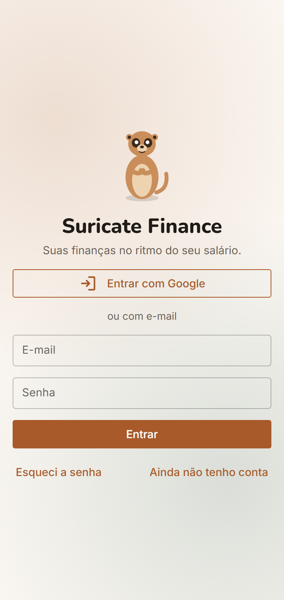 | 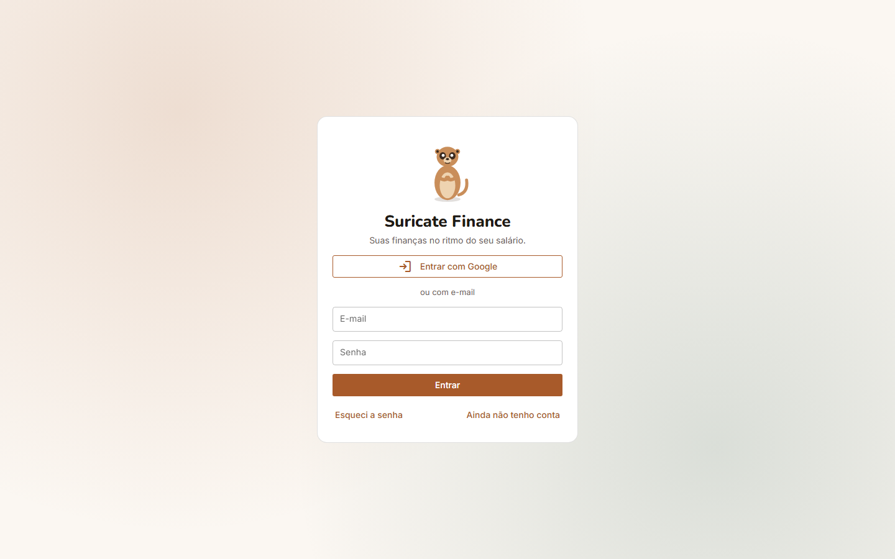 |
| Criar conta (aceite corrigido, A2) | 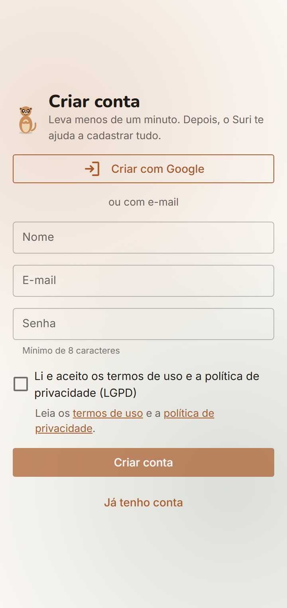 | 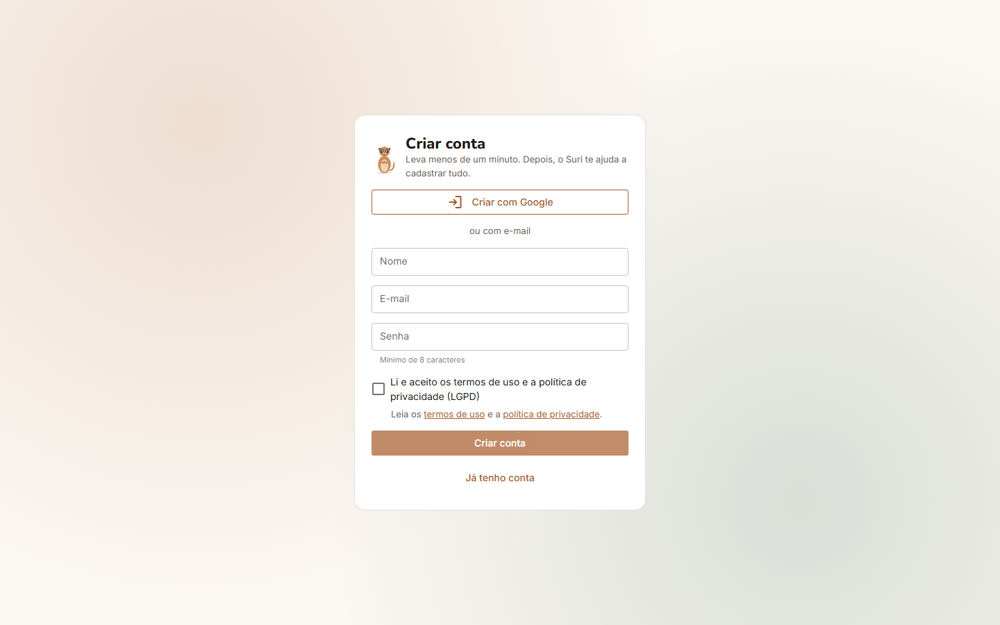 |
| Esqueci a senha | 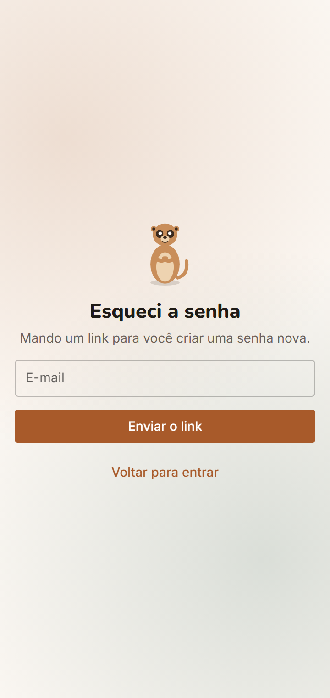 | 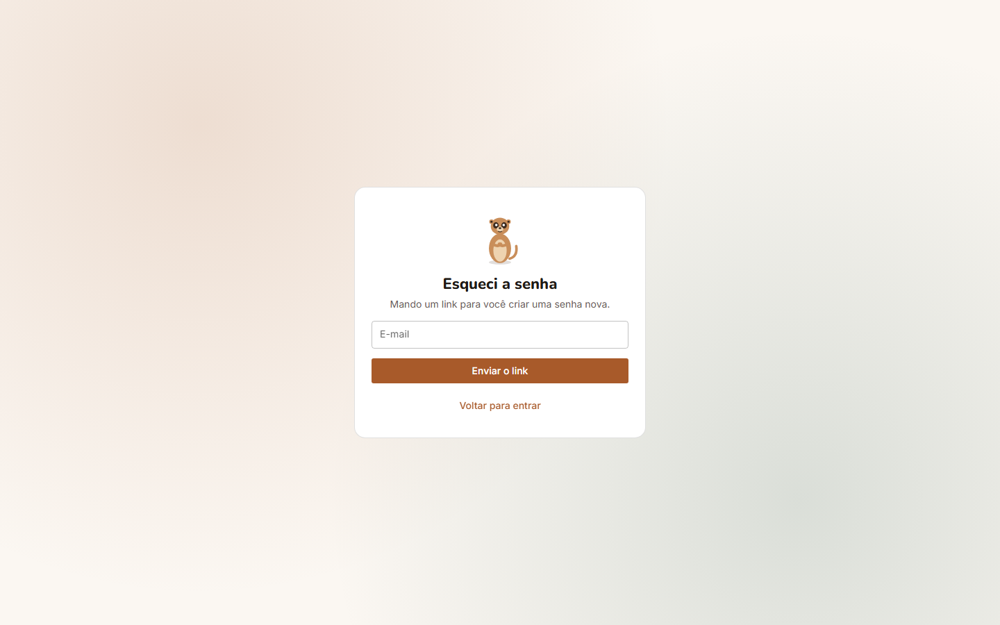 |
| Cadastro guiado | 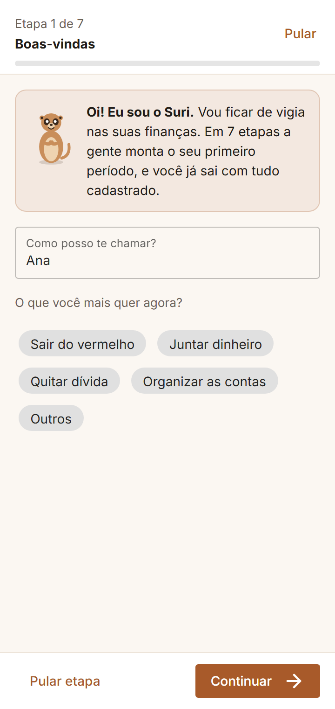 | 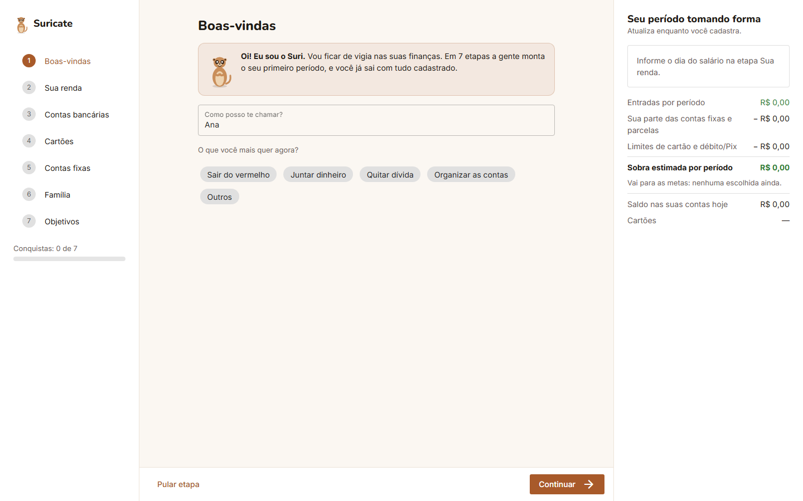 |
| Configurações | 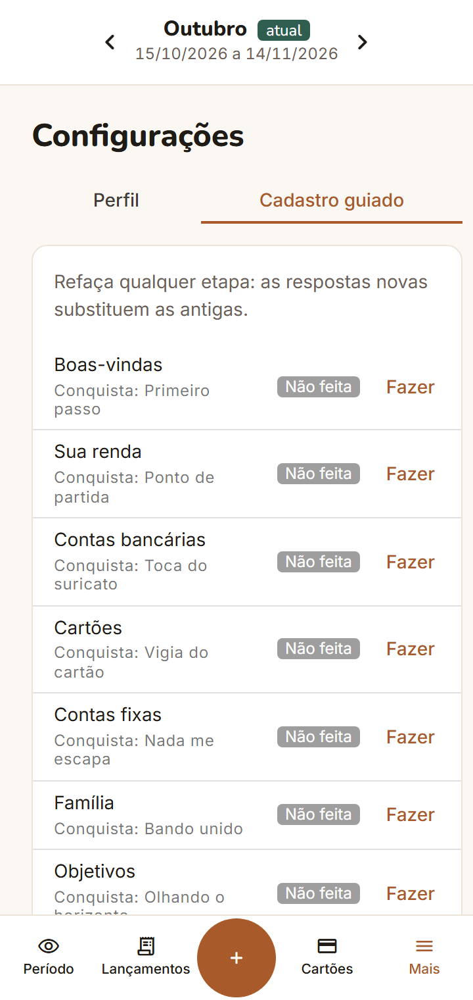 | 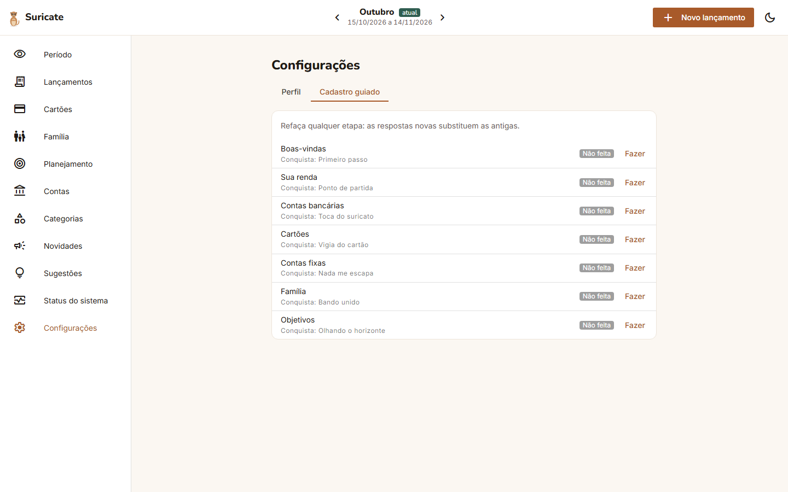 |
| Sugestões | 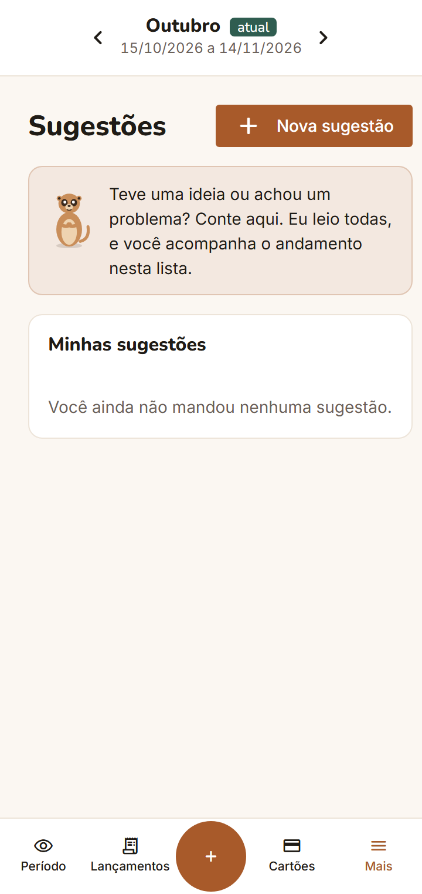 | 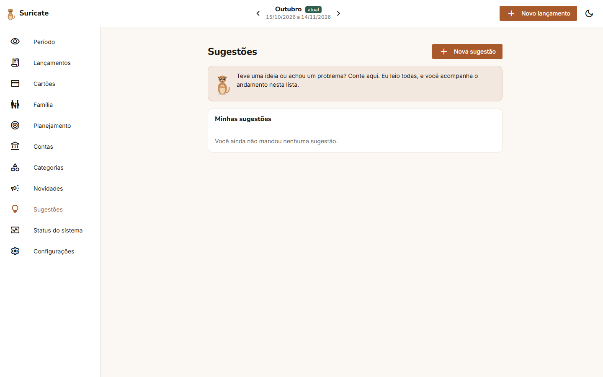 |

Foco pelo teclado no botão "Entrar com Google" (A4):

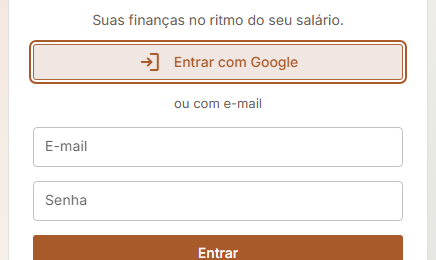

As capturas usam uma conta de teste nova, por isso Sugestões aparece com a lista vazia. Para gerar as capturas das telas públicas de novo: `cd e2e && E2E_BASE_URL=http://localhost:9001 node capturas.mjs ../docs/modulos/m2-acesso-onboarding/img /entrar:entrar /criar-conta:criar-conta /esqueci-a-senha:esqueci-a-senha`
