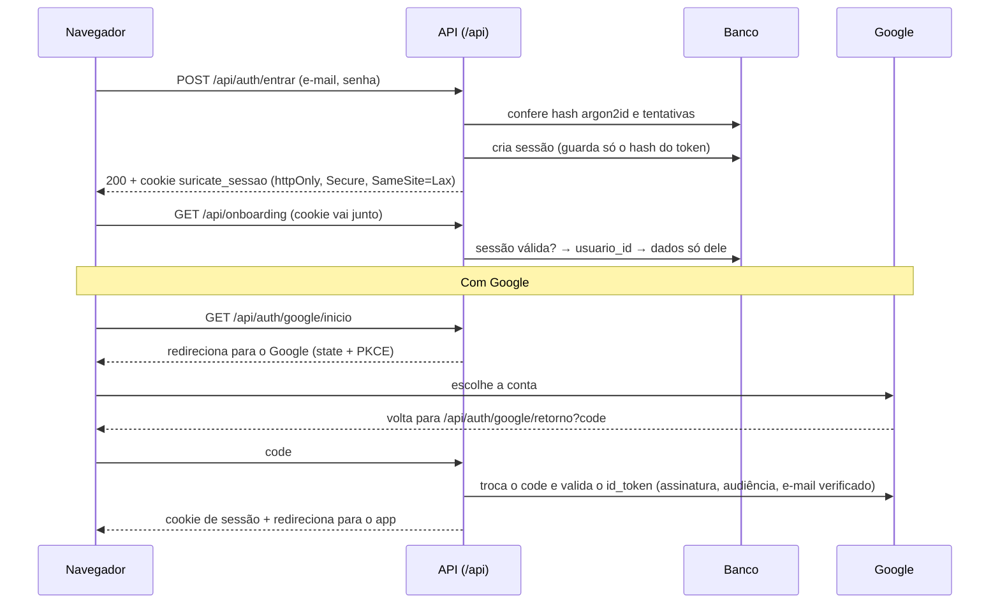
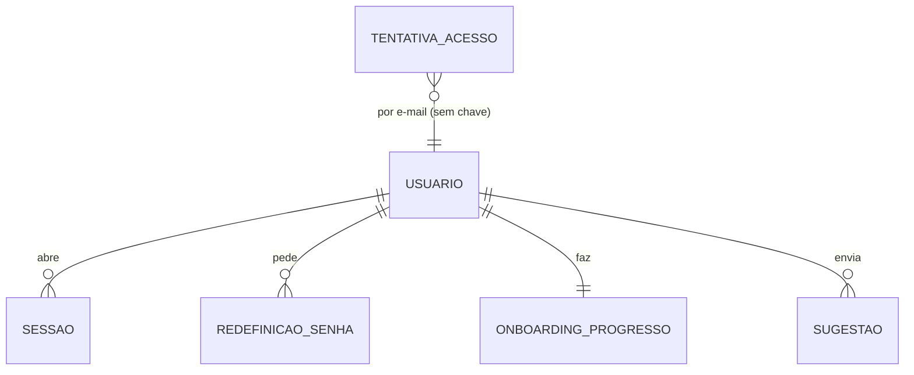

# M2 · Acesso e onboarding do Suri: documentação técnica

O M2 abre o Suricate para uso pessoal. A pessoa cria a conta (e-mail e senha, ou Google) e entra com segurança. Depois, faz o cadastro guiado do Suri em 7 etapas, com progresso e conquistas, e pode retomar ou refazer qualquer etapa. O módulo também entrega a aba Sugestões, ligada ao GitHub (#106).

Referências: [Análise e Requisitos](https://claude.ai/code/artifact/383dc308-00c9-4c01-9659-85308904fd79) (RF01–RF04, RN01–RN05, RNF03, RNF04, RNF07), [mapa de telas](../../prototipos/mapa-de-telas.md) (T01, T02, T03, T16), [revisão dos protótipos](../../prototipos/revisao.md) e a [documentação técnica do M1](../m1-fundacao/tecnico.md) (seções 7 e 16).

## 1. Escopo

| Requisito | Entra no M2 | Fica para depois |
| --- | --- | --- |
| RF01 Cadastro e login | E-mail e senha, conta Google, sair, esqueci a senha, aceite dos termos | Login com Apple; verificação de e-mail obrigatória |
| RF02 Cada um vê só os seus dados | Sessão por usuário; toda rota de dados exige login e filtra por `usuario_id`; testes de isolamento | Perfis chefe e membro da família (Fase 3, RF37–RF39) |
| RF03 Cadastro guiado | As 7 etapas do protótipo T03, conquistas, barra de progresso e a prévia do período no desktop | Cálculo real do período com fim de semana e feriado (M3) |
| RF04 Retomar e refazer | Volta para a etapa onde parou; em Configurações, refaz qualquer etapa | O resto de Configurações (regras do período no M3) |
| #106 Sugestões | Aba Sugestões que abre issue no GitHub e mostra o status | Sugestão entregue aparecendo em Novidades (automático depois) |
| RNF04 LGPD | Termos e política de privacidade, aceite registrado, excluir a própria conta (ver D3) | Exportar os dados (junto com o backup .xlsx da RN31) |

## 2. Decisões para o Phelipe

| # | Pergunta | Recomendo | Alternativa |
| --- | --- | --- | --- |
| D1 | Onde o cadastro guiado grava contas, cartões, contas fixas, família e metas, se as telas e regras dessas coisas só chegam do M3 ao M7? | **Respostas por etapa em JSON** na tabela do cadastro guiado, validadas pela API. Cada módulo seguinte cria as próprias tabelas e uma migração que importa essas respostas. Os módulos ficam independentes e nada é desenhado antes da hora | Criar agora as tabelas definitivas (`conta`, `cartao`…) só com os campos do cadastro. A pessoa veria tudo nas telas futuras sem importação, mas o M2 desenharia o modelo de quatro módulos antes de eles serem pensados |
| D2 | Como enviar o e-mail de "esqueci a senha"? | **Gmail com senha de app** (grátis, até 500 e-mails por dia), saindo de um endereço criado só para o Suricate. Troca para o Resend quando houver domínio próprio | Resend já agora: exige domínio próprio para mandar e-mail a outras pessoas · Deixar sem "esqueci a senha" no M2: quem esquecer entra com Google |
| D3 | "Excluir minha conta" entra no M2? | **Sim**, em Configurações, com confirmação. É o mínimo da LGPD para quem testar | Deixar para a Fase 2, junto com exportar os dados |
| D4 | Login com Google nos previews de `feature/*` | **Só nos endereços fixos:** produção, pré-produção, `develop` e a máquina local. O Google exige cadastrar cada endereço, e o de cada preview muda. Nos previews de `feature/*` funciona o e-mail e senha | Domínio próprio com subdomínios fixos por ramo (custo do domínio) |

As seções abaixo já seguem as recomendações. Se alguma mudar na revisão, eu ajusto antes do desenvolvimento.

## 3. Arquitetura do acesso

Front e API estão no mesmo domínio (seção 2 do M1), então a sessão usa um **cookie `httpOnly`**: o JavaScript da página não lê o cookie, e o navegador o envia sozinho para `/api`.

| Tema | Como fica | Por quê |
| --- | --- | --- |
| Senha | `argon2id` (biblioteca `pwdlib`), mínimo de 8 caracteres | Padrão atual para guardar senhas (RNF03) |
| Sessão | Token aleatório de 32 bytes no cookie; no banco, só o hash SHA-256. Validade de 30 dias, renovada com o uso | Dá para encerrar uma sessão (sair, excluir conta) e um vazamento do banco não entrega sessões |
| Proteção contra CSRF | Cookie `SameSite=Lax` e cabeçalho `X-Suricate: 1` obrigatório em `POST`, `PUT`, `PATCH` e `DELETE` | Outro site não consegue mandar esse cabeçalho sem CORS, e a API não libera CORS |
| Força bruta | 5 senhas erradas no mesmo e-mail em 15 minutos bloqueiam esse e-mail por 15 minutos; 30 erros por IP em 15 minutos bloqueiam o IP | As funções da Vercel não guardam memória, então a contagem fica no banco |
| Conta Google | Pelo `sub` do Google. Se o e-mail verificado já tem conta com senha, as duas formas passam a valer para a mesma conta | A pessoa não fica com duas contas |
| Mensagens de erro | "E-mail ou senha incorretos", sem dizer qual; "esqueci a senha" sempre responde "se o e-mail existir, mandamos o link" | Não revela quem tem conta |
| Administrador | Campo `papel` (`usuario` ou `admin`); vira `admin` quem está em `ADMIN_EMAILS` | Prepara o `/admin` (#102) |

## 4. Banco de dados

| Tabela | Campos novos ou principais | Observação |
| --- | --- | --- |
| `usuario` (M1) | `apelido`, `senha_hash` (pode ser nulo: só Google), `google_sub` (único), `email_verificado`, `termos_versao`, `termos_aceitos_em`, `papel` | E-mail guardado em minúsculas, único |
| `sessao` | `usuario_id`, `token_hash` (único), `expira_em`, `ultimo_uso_em`, `dispositivo` (texto curto do navegador) | Apagada ao sair; todas apagadas ao trocar a senha |
| `redefinicao_senha` | `usuario_id`, `token_hash`, `expira_em` (1 hora), `usado_em` | O link vale uma vez |
| `tentativa_acesso` | `email`, `ip`, `sucesso`, `criado_em` | Tentativas com mais de 1 dia são apagadas a cada login |
| `onboarding_progresso` | `usuario_id` (único), `etapa_atual`, `etapas` (JSON: status, respostas e data de cada etapa), `conquistas` (lista), `concluido_em` | D1. Tipo JSON do SQLAlchemy, que funciona no Postgres e no SQLite dos testes |
| `sugestao` | `usuario_id`, `codigo` (ex.: `S-7F3K`), `tipo`, `titulo`, `tela`, `issue_numero`, `status`, `status_lido_em` | Guarda só o necessário para listar; o texto completo fica na issue |

Todas as tabelas seguem as convenções do M1: `id` UUID, `criado_em`, `atualizado_em` e chave estrangeira para `usuario` com `ON DELETE CASCADE`. Por isso, excluir a conta apaga tudo (D3).

**Seed de desenvolvimento:** o usuário 1 fictício ganha uma senha de teste, lida de `SEED_SENHA` no ambiente `development` do GitHub. Ela nunca vai para o código.

## 5. API

Todas as rotas de dados exigem sessão (`401` sem login) e respondem só com dados do próprio usuário. Um recurso de outra pessoa responde `404`, nunca `403`, para não revelar que ele existe.

| Método | Rota | O que faz |
| --- | --- | --- |
| `POST` | `/api/auth/cadastro` | Nome, e-mail, senha e aceite dos termos → cria a conta e a sessão (`201`) |
| `POST` | `/api/auth/entrar` | E-mail e senha → sessão; `401` genérico; `429` quando bloqueado |
| `POST` | `/api/auth/sair` | Apaga a sessão e o cookie |
| `GET` | `/api/auth/eu` | Usuário logado, papel e resumo do cadastro guiado (etapa atual, concluído ou não) |
| `GET` | `/api/auth/google/inicio` | Redireciona para o Google |
| `GET` | `/api/auth/google/retorno` | Valida o retorno, cria ou liga a conta, abre a sessão e redireciona para o app |
| `POST` | `/api/auth/termos` | Aceite dos termos (quem entrou com Google pela primeira vez) |
| `POST` | `/api/auth/senha/esqueci` | Envia o link de redefinição (sempre `202`) |
| `POST` | `/api/auth/senha/redefinir` | Token e senha nova → troca a senha e encerra as outras sessões |
| `GET` | `/api/onboarding` | Progresso, respostas de cada etapa e conquistas |
| `PUT` | `/api/onboarding/etapas/{etapa}` | Grava as respostas da etapa, marca como concluída e dá a conquista |
| `POST` | `/api/onboarding/etapas/{etapa}/pular` | Marca a etapa como pulada (sem conquista) e avança |
| `POST` | `/api/onboarding/concluir` | Fecha o cadastro guiado |
| `PATCH` | `/api/usuario` | Nome e apelido |
| `DELETE` | `/api/usuario` | Exclui a conta e tudo dela; pede a senha ou, para conta só Google, digitar "EXCLUIR" |
| `POST` | `/api/sugestoes` | Cria a sugestão e a issue no GitHub |
| `GET` | `/api/sugestoes` | Lista as sugestões da pessoa com o status |

## 6. Cadastro guiado (RF03, RF04)

O formato segue a decisão do PR #97: são telas com formulário e lista, não um chat. As opções aparecem como chips, e "Outros" abre um campo. Toda múltipla escolha tem "Não sei", e as perguntas de detalhe só aparecem quando fazem sentido.

| # | Etapa (`chave`) | Respostas gravadas | Validação | Conquista |
| --- | --- | --- | --- | --- |
| 1 | Boas-vindas (`boas_vindas`) | Apelido; objetivo (sair do vermelho, juntar dinheiro, quitar dívida, organizar as contas ou outro, com texto) | Apelido de 1 a 40 caracteres | Primeiro passo |
| 2 | Sua renda (`renda`) | Dia do salário; valor médio; fim de semana (antecipa, adia, não muda, não sei); se atrasa e quantos dias; outras entradas (descrição, dia, valor) | Dia de 1 a 31; valores ≥ 0; "não sei" vira "não muda" com aviso (RN03) | Ponto de partida |
| 3 | Contas bancárias (`contas`) | Lista: nome, banco (chips ou outro), tipo (corrente, poupança, investimentos, VR/VA, dinheiro, familiar), saldo de hoje | Nome obrigatório; saldo pode ser negativo | Toca do suricato |
| 4 | Cartões (`cartoes`) | Lista: nome, limite, dia de fechamento, dia de vencimento | Dias de 1 a 31; limite ≥ 0 | Vigia do cartão |
| 5 | Contas fixas (`contas_fixas`) | Contas fixas (sugeridas ou digitadas: descrição, dia, valor, não pode atrasar); parcelas e financiamentos (descrição, valor da parcela, total, já pagas) | `pagas` ≤ `total`; o app mostra "faltam N" (decisão do PR #98) | Nada me escapa |
| 6 | Família (`familia`) | Divide ou não; com quem; percentual da outra pessoa; conta familiar (uma das contas da etapa 3 ou "ainda não tenho"); cartão do casal; quais contas fixas e parcelas são divididas | Percentual de 0 a 100; referências a contas e cartões que existem nas respostas | Bando unido |
| 7 | Objetivos (`objetivos`) | Metas em ordem de prioridade (chips ou outra); limite por período no cartão e no débito/Pix | Valores ≥ 0 | Olhando o horizonte |

- **Itens com id próprio:** cada conta, cartão e conta fixa recebe um id (UUID) no front. Assim a etapa Família aponta para eles mesmo que a pessoa renomeie depois.
- **Validação dupla:** o front valida para dar resposta rápida, e a API valida de novo com um schema Pydantic por etapa (`422` com a mensagem do campo).
- **Retomar (RF04):** `etapa_atual` guarda onde a pessoa parou. Ao entrar com o cadastro incompleto, o app abre nessa etapa; "Pular", no topo, leva ao início, que mostra "Continue seu cadastro (3 de 7)".
- **Refazer (RF04):** em Configurações › Cadastro guiado, cada etapa aparece com o status (concluída, pulada, não feita) e o botão "Refazer". Refazer abre a etapa com as respostas atuais, e salvar substitui as respostas. A conquista já ganha continua.
- **Prévia do período (desktop):** é calculada no front por uma função pura, testada com Vitest, com a fórmula do protótipo. As **entradas** somam o salário e as outras entradas. Delas saem a **sua parte das contas fixas e parcelas** (descontado o percentual da outra pessoa nos itens divididos) e os **limites** de cartão e de débito/Pix, e o resultado é a **sobra estimada**. O nome e as datas do primeiro período seguem a RN02 ("Outubro · 15/10/2026 a 14/11/2026"), ainda sem o ajuste de fim de semana, que chega no M3.
- **Fechamento:** o Suri comemora, mostra o primeiro período e os totais (contas, cartões, contas fixas, sobra estimada) e leva ao início.

## 7. Telas

| Tela | Rota | Origem | Observação |
| --- | --- | --- | --- |
| T01 Boas-vindas e login | `/entrar` | Protótipo | "Entrar com Google", e-mail e senha, "Esqueci a senha", "Criar conta" |
| T02 Cadastro | `/criar-conta` | Protótipo | Nome, e-mail, senha e aceite dos termos (botão só habilita com o aceite) |
| Aceite dos termos | `/boas-vindas` | Nova | Só no primeiro login com Google: o Suri, os links e o botão "Aceito e continuar" |
| Esqueci e redefinir senha | `/esqueci-a-senha`, `/redefinir-senha` | Nova | Mesmo cartão central do T01; campo de e-mail ou de senha nova |
| Termos e privacidade | `/termos`, `/privacidade` | Nova | Texto simples, com a versão e a data. O Claude escreve um rascunho, que você revisa |
| T03 Cadastro guiado | `/cadastro-guiado/:etapa` | Protótipo | Celular: uma etapa por tela, "Continuar" no rodapé. Desktop: etapas à esquerda, formulário no centro, prévia à direita |
| T16 Configurações (parte) | `/configuracoes` | Protótipo | Abas **Perfil** (nome, apelido, e-mail, sair, excluir conta) e **Cadastro guiado** (refazer etapas). As abas de regras do período chegam no M3 |
| Sugestões | `/sugestoes` | Nova | Item no menu "Mais" (celular) e na barra lateral. Lista "Minhas sugestões" com o status em chip; botão "Nova sugestão" abre um formulário (tipo em chips, título, descrição, aviso de dados pessoais). A tela de origem vai junto, preenchida automaticamente |

**Guardas de rota:** sem sessão, só `/entrar`, `/criar-conta`, as telas de senha, os termos, `/status` e `/novidades` abrem; o resto leva a `/entrar` e volta para onde a pessoa queria ir depois do login. Com sessão e sem o aceite dos termos, tudo leva a `/boas-vindas`.

## 8. Sugestões (#106)

Segue o desenho aprovado na seção 16 do M1, com estes detalhes:

| Ponto | Como fica |
| --- | --- |
| Issue | Título `[Sugestão S-7F3K] <título>`; corpo com tipo, tela, versão do app e o texto; labels `sugestao-usuario` e `triagem`; milestone "Sugestões dos usuários" |
| Dados pessoais | O código `S-7F3K` não identifica a pessoa. Antes de enviar, a API mascara e-mails, telefones, CPF e números de cartão no texto, e o formulário avisa |
| Status para o cliente | Aberta com `triagem` = recebida; aberta em outro milestone = planejada; fechada como concluída = entregue; fechada como "não planejada" = não será feita |
| Leitura do status | Ao abrir a aba, a API consulta no GitHub as issues lidas há mais de 10 minutos |
| Limite | 5 por dia por usuário (`429` depois disso) |
| Token | `GITHUB_SUGESTOES_TOKEN`: token *fine-grained* só deste repositório, com permissão de issues (leitura e escrita) |

## 9. Variáveis novas

| Variável | Onde | Quem cria |
| --- | --- | --- |
| `GOOGLE_CLIENT_ID`, `GOOGLE_CLIENT_SECRET` | Vercel (Production e Preview) | 🧑 no Google Cloud, com o Claude guiando tela por tela |
| `SMTP_HOST`, `SMTP_USUARIO`, `SMTP_SENHA`, `EMAIL_REMETENTE` | Vercel | 🧑 (senha de app do Gmail, D2) |
| `GITHUB_SUGESTOES_TOKEN` | Vercel | 🧑 no GitHub, com o Claude guiando |
| `ADMIN_EMAILS` | Vercel | 🤖 (seu e-mail) |
| `APP_URL` | Vercel, por ambiente | 🤖 (para montar os links dos e-mails e o retorno do Google) |
| `SEED_SENHA` | GitHub, ambiente `development` | 🧑 |

Endereços de retorno a cadastrar no Google (D4): `https://suricatefinance.vercel.app`, `https://suricatefinance-git-staging-phafonsos-projects.vercel.app`, `https://suricatefinance-git-develop-phafonsos-projects.vercel.app` e `http://localhost:9001`, cada um com `/api/auth/google/retorno`.

## 10. Casos de teste previstos

| # | Camada | Caso | Resultado esperado |
| --- | --- | --- | --- |
| CT18 | API | Cadastro com e-mail novo | `201`, cookie `httpOnly`, senha guardada só como hash |
| CT19 | API | Cadastro com e-mail repetido (maiúsculas ou espaços) | `409` |
| CT20 | API | Login com senha certa e errada | `200` com sessão; `401` com mensagem genérica |
| CT21 | API | 6ª senha errada em 15 minutos | `429`, mesmo com a senha certa |
| CT22 | API | Rotas de dados sem sessão, com sessão expirada ou depois de sair | `401` |
| CT23 | API | `POST` sem o cabeçalho `X-Suricate` | `403` |
| CT24 | API | Login com Google (Google simulado): conta nova, conta existente com o mesmo e-mail, `id_token` inválido | Cria; liga; recusa |
| CT25 | API | Esqueci a senha: e-mail existente e inexistente; link usado duas vezes; link vencido | `202` nos dois; redefine uma vez; recusa |
| CT26 | API | **Isolamento (RF02):** usuário B tenta ler e alterar o cadastro guiado e as sugestões de A | `404` em tudo, nada muda |
| CT27 | API | Etapa com resposta inválida (dia 32, pagas > total, percentual 120) | `422` com o campo |
| CT28 | API | Concluir, pular e refazer etapa | Conquista só ao concluir; pular não dá conquista; refazer mantém a conquista |
| CT29 | API | Excluir a conta | Some a conta, as sessões, o cadastro e as sugestões |
| CT30 | API | Sugestão (GitHub simulado) | Issue com labels, milestone e texto mascarado; 6ª no dia → `429` |
| CT31 | Front | Prévia do período | Fórmula do protótipo, com e sem divisão; nome e datas pela RN02 |
| CT32 | Front | Formulários das etapas | Campos condicionais (dias de atraso, família), "Outros" abre campo, "Não sei" presente |
| CT33 | Front | Guardas de rota | Sem sessão vai para `/entrar` e volta para onde ia; cadastro incompleto abre na etapa salva |
| CT34 | E2E | Criar conta, fazer as 7 etapas e ver o fechamento, no celular e no desktop | Termina no início com 7 conquistas |
| CT35 | E2E | Sair no meio do cadastro e entrar de novo | Volta na mesma etapa (RF04) |
| CT36 | E2E | Refazer a etapa Cartões em Configurações | Respostas novas na prévia |
| CT37 | Acessibilidade | Telas de login e cadastro guiado | Rótulos em todos os campos, foco visível, navegação por teclado (RNF07) |

Os testes de ponta a ponta criam contas com e-mail `e2e+<aleatório>@teste.suricate.app` no banco `dev`. Uma limpeza apaga essas contas uma vez por dia.

## 11. Tarefas da etapa 2

Viram sub-issues de "[M2] 2. Desenvolvimento" quando este documento for aprovado:

1. Modelo e migração: campos novos em `usuario`, `sessao`, `redefinicao_senha`, `tentativa_acesso`, `onboarding_progresso`, `sugestao`.
2. Cadastro, login, sair e sessão por cookie, com proteção contra CSRF e força bruta (RF01).
3. Isolamento por usuário: dependência `usuario_atual` e testes de isolamento (RF02, #15).
4. Login com Google (RF01, #14).
5. Esqueci a senha com envio de e-mail (RF01, D2).
6. Telas T01 e T02, aceite dos termos, termos e privacidade, guardas de rota.
7. API do cadastro guiado: etapas, pular, concluir, conquistas (RF03, #16).
8. Telas do cadastro guiado: as 7 etapas, conquistas e a prévia no desktop (RF03, #16).
9. Retomar e refazer, com a parte de Configurações e "Excluir minha conta" (RF04, #17, D3).
10. Aba Sugestões ligada ao GitHub (#106).
11. Novidades: entrada no `CHANGELOG.md` para a próxima versão.

## 12. O que preciso do Phelipe

- **Decidir D1 a D4** (seção 2), comentando no PR.
- **Google Cloud:** criar o projeto e o cliente OAuth. Eu abro cada tela e preencho o que não for segredo; você copia o ID e o segredo para a Vercel.
- **Gmail do Suricate** (se D2 ficar como recomendo): criar a conta, ativar a verificação em duas etapas e gerar a senha de app.
- **Token do GitHub para as sugestões**, com a mesma condução.
- **Revisar o texto dos termos e da política de privacidade.** Eu escrevo um rascunho, mas ele não substitui a revisão de um advogado antes de abrir para outras pessoas.

## 13. Riscos

| Risco | Efeito | Como tratamos |
| --- | --- | --- |
| Banco do Neon "acordando" no primeiro login | Login demora alguns segundos | O botão mostra o carregamento; a API tenta conectar de novo uma vez |
| Gmail marcar os e-mails como spam ou limitar o envio | Link de senha não chega | Texto simples, sem anexos; Resend quando houver domínio (D2) |
| App do Google em modo "teste" | Só e-mails cadastrados como testadores entram com Google | Basta enquanto só você usa; a verificação do Google fica para antes de abrir ao público |
| JSON do cadastro guiado mudar de formato (D1) | Respostas antigas incompatíveis | Cada etapa guarda `versao`; a importação de cada módulo trata as versões |
| Termos sem revisão jurídica | Risco legal ao abrir para outras pessoas | Rascunho marcado como tal; revisão antes da Fase 3 |

## Fontes

- [OWASP Password Storage Cheat Sheet](https://cheatsheetseries.owasp.org/cheatsheets/Password_Storage_Cheat_Sheet.html) e [Session Management Cheat Sheet](https://cheatsheetseries.owasp.org/cheatsheets/Session_Management_Cheat_Sheet.html)
- [Google: OpenID Connect](https://developers.google.com/identity/openid-connect/openid-connect)
- [Gmail: senhas de app](https://support.google.com/accounts/answer/185833) e [limites de envio](https://support.google.com/mail/answer/22839)
- [GitHub: fine-grained personal access tokens](https://docs.github.com/en/authentication/keeping-your-account-and-data-secure/managing-your-personal-access-tokens)
