# M0 · Roteiro de navegação dos protótipos

Este roteiro leva quem abre os protótipos pela primeira vez por todas as 16 telas do MVP, em cerca de 15 minutos. Cada tela traz para que ela serve e o que vale experimentar.

## Como abrir

- **No navegador:** [Suricate Finance Protótipos](https://claude.ai/artifact/F4UQid2qyArpUT2cy19cPu) (página privada; precisa ser compartilhada para outras pessoas abrirem).
- **No computador:** na pasta `prototipos/`, rode `python -m http.server 8765` e abra `http://127.0.0.1:8765/`.

## Os controles da moldura

| Controle | Onde | O que faz |
| --- | --- | --- |
| Telas | Barra lateral, em cima | Abre qualquer tela de T01 a T16 |
| Fluxos | Barra lateral, embaixo | Percorre F1 a F5 passo a passo; cada passo é um link |
| Ver | Topo | Lado a lado, só celular (360 px) ou só desktop (1440 px, reduzido para caber) |
| Tema | Topo | Claro ou escuro |

O celular e o desktop mostram o mesmo estado: o que você faz em um aparece no outro. Nada é salvo, e os dados são fictícios, com a estrutura do usuário 1.

## Ordem sugerida

1. **F1 · Primeiro acesso:** T01 → T03 (as 7 etapas) → T04.
2. **F4 · Quanto posso gastar?:** T04 → T13 → T07.
3. **F2 · Compra no cartão:** "+" → T06 → T08.
4. **F3 · Ritual do salário:** T04 → T12.
5. **F5 · Virar o período:** as setas do seletor de período.
6. As telas de apoio: T05, T15, T10, T11, T09, T14, T16.

## Tela por tela

### T01 · Boas-vindas e login

Entrada do app: "Entrar com Google" ou e-mail e senha. "Ainda não tenho conta" leva ao T02. No desktop, o cartão fica centralizado sobre o fundo ilustrado.

### T02 · Cadastro

Nome, e-mail, senha e o aceite dos termos (LGPD). "Criar conta" só fica ativo com o aceite marcado e leva ao cadastro guiado.

### T03 · Cadastro guiado pelo Suri

O usuário monta o primeiro período em 7 etapas e já sai com tudo cadastrado.

| Celular | Desktop |
| --- | --- |
| 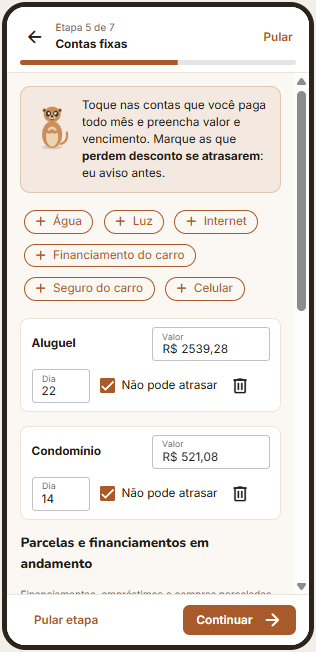 | 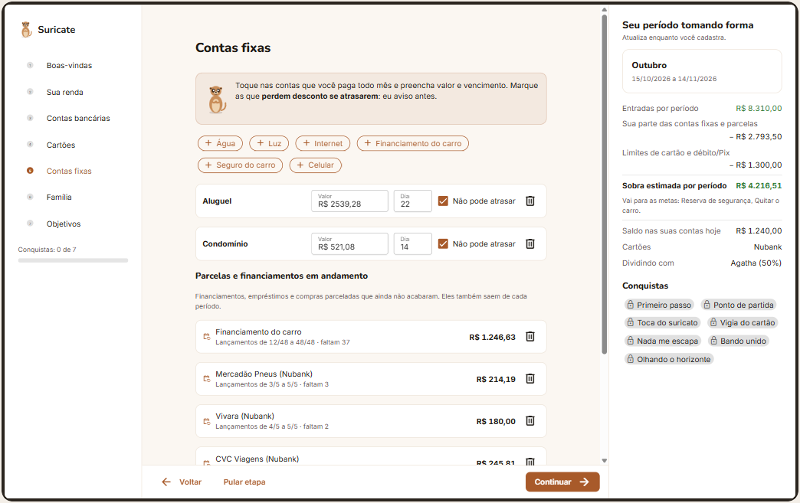 |

**Experimente:**
- Na etapa **Sua renda**, mude o dia do salário: a dica do Suri mostra o novo período na hora. Ligue "O salário costuma atrasar" para ver a pergunta extra aparecer.
- Em **Contas bancárias** e **Cartões**, preencha o formulário de baixo e toque em "Adicionar": o item entra na lista.
- Em **Contas fixas**, toque em "+ Água" e preencha valor e dia. Em "Parcelas e financiamentos", informe quantas eram e quantas já pagou: o app mostra a faixa dos lançamentos (ex.: 12/48 a 48/48).
- Em **Família**, desmarque uma conta dividida e veja a "sobra estimada" mudar na prévia à direita (desktop).
- Cada "Continuar" desbloqueia uma conquista.

### T04 · Painel do período

A tela inicial: quanto ainda dá para gastar neste período e o que vence.

| Celular | Desktop |
| --- | --- |
| 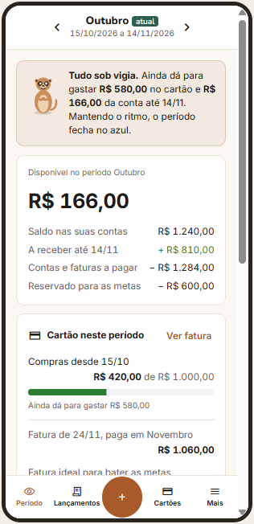 | 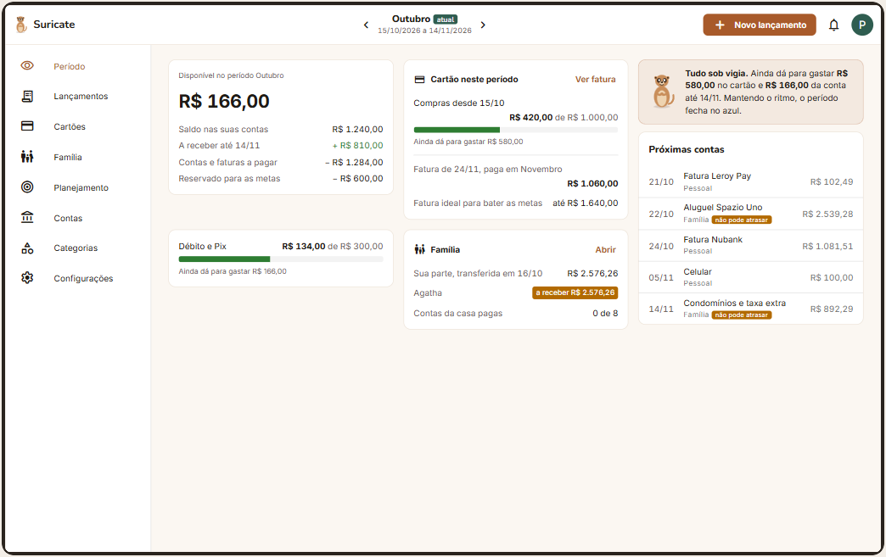 |

**Experimente:**
- Leia a conta do **disponível**: saldo + a receber − contas a pagar − reserva das metas = R$ 166,00.
- Em **Cartão neste período**, toque em "Ver fatura" (T08).
- Toque numa das **próximas contas**: as pessoais abrem o detalhe (T15), as da família abrem a T12.
- Use as setas do seletor para ver Setembro (período fechado) e Novembro (período futuro).

### T05 · Lançamentos do período

Tudo o que entrou e saiu no período, agrupado por dia no celular e em tabela no desktop. Os filtros (Despesas, Receitas, Cartão, Pendentes) mudam a lista. Toque num lançamento para abrir a T15.

### T06 · Novo lançamento

Abre pelo "+" (celular) ou "Novo lançamento" (desktop).

| Celular | Desktop |
| --- | --- |
| 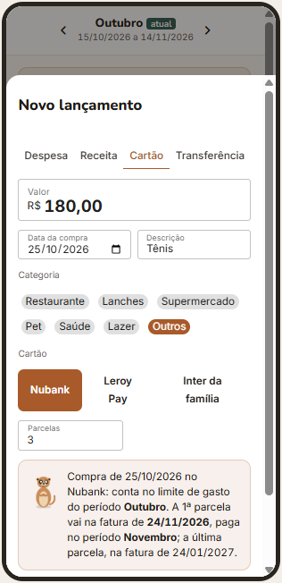 | 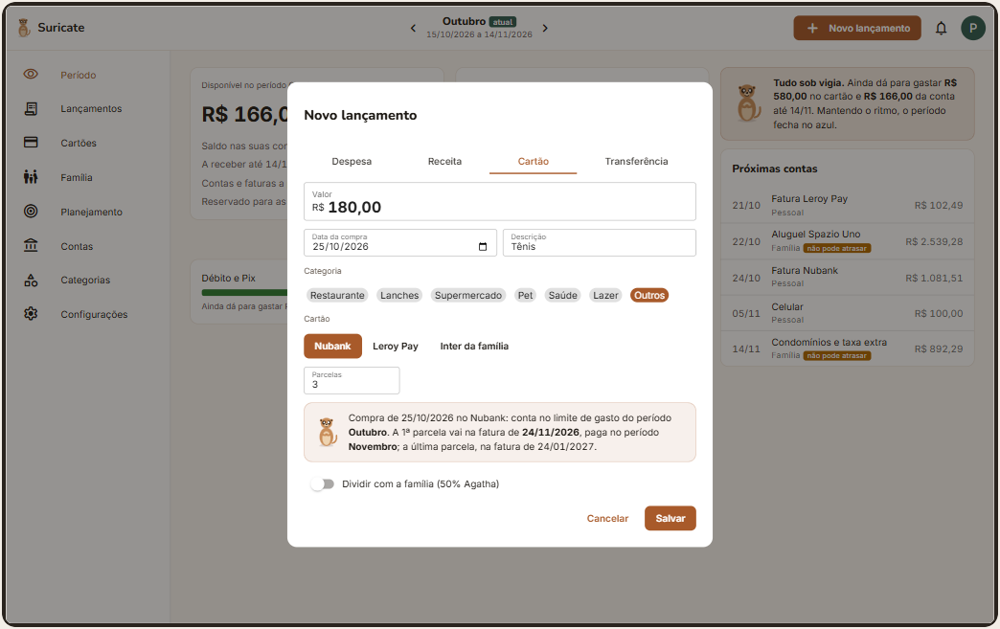 |

**Experimente:**
- Na aba **Cartão**, mude a data da compra para 16/10: o Suri avisa que a compra entra na fatura que você paga ainda neste período.
- Mude as parcelas para 6 e veja a data da última fatura.
- Na aba **Transferência**, veja o aviso de que o valor para a conta familiar vira comprometido.

### T07 · Cartões

Os três cartões, com a alternância entre **visão gasto** (compras feitas neste período, que contam nos limites) e **visão caixa** (faturas pagas neste período).

### T08 · Fatura do cartão

A fatura aberta do Nubank, com a data real de cada compra e as parcelas antigas (3/5, 4/5, 6/10).

| Celular | Desktop |
| --- | --- |
| 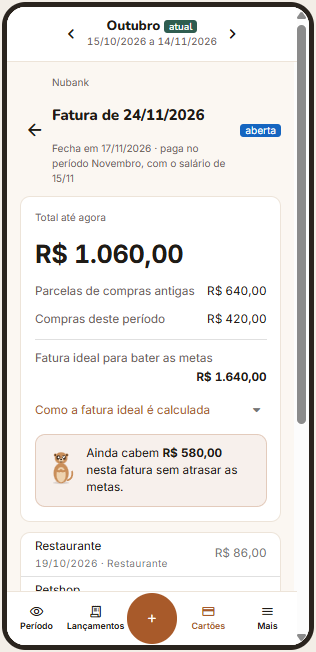 | 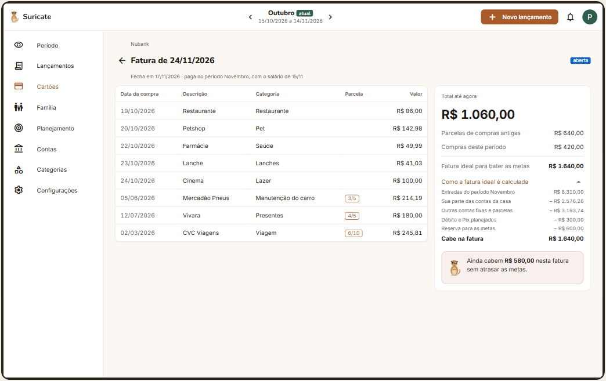 |

**Experimente:** abra "Como a fatura ideal é calculada" para ver de onde vem o limite de R$ 1.640,00.

### T09 · Novo cartão

Limite, nome, bandeira, conta que paga, fechamento e vencimento. A dica do Suri explica, com os dias digitados, para qual fatura as compras vão.

### T10 · Contas

Saldo das suas contas e da conta familiar, separados. A conta familiar mostra que o dinheiro é da casa e não entra no seu disponível.

### T11 · Nova conta

Saldo, nome, banco, tipo e cor. Escolha o tipo "Familiar" e veja "Entra no meu disponível" desligar sozinho.

### T12 · Família

A conta familiar: contas da casa, repasses e o cartão do casal.

| Celular | Desktop |
| --- | --- |
| 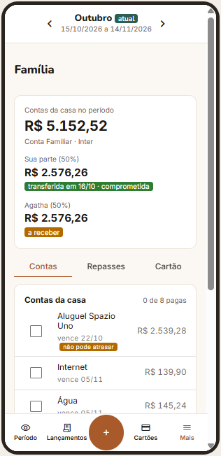 | 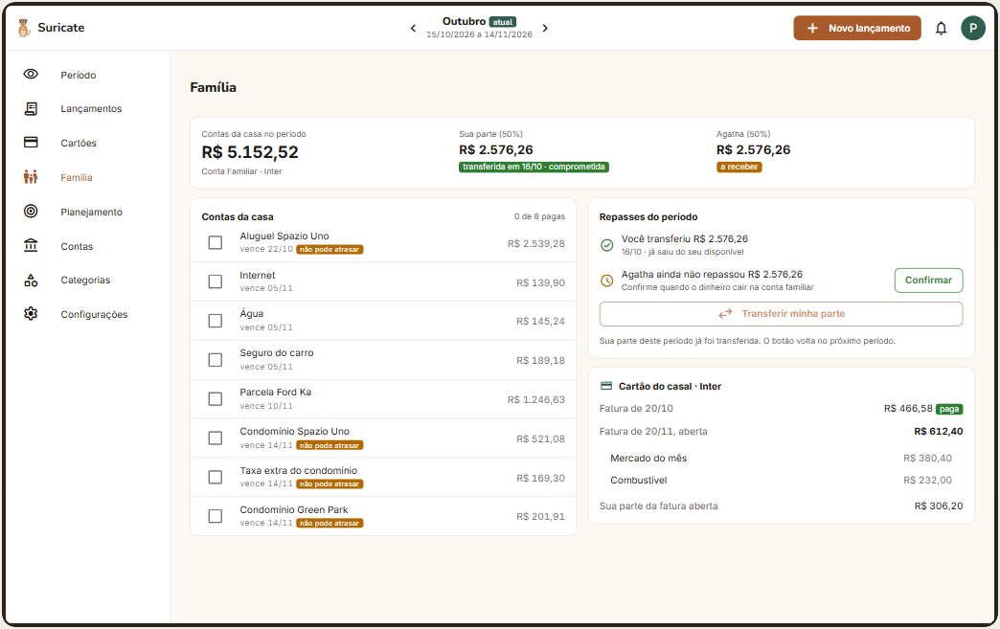 |

**Experimente:**
- Marque contas como pagas: o contador "0 de 8 pagas" e o painel (T04) acompanham.
- Toque em "Confirmar" no repasse da Agatha: o status muda para "repassada" aqui e no painel.

### T13 · Planejamento do período

Limites de cartão e de débito/Pix, e o limite de cada categoria, contados pela data da compra.

| Celular | Desktop |
| --- | --- |
| 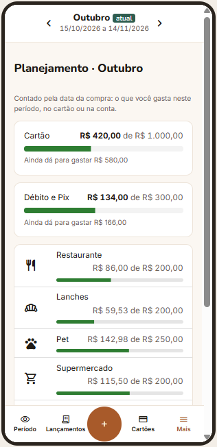 | 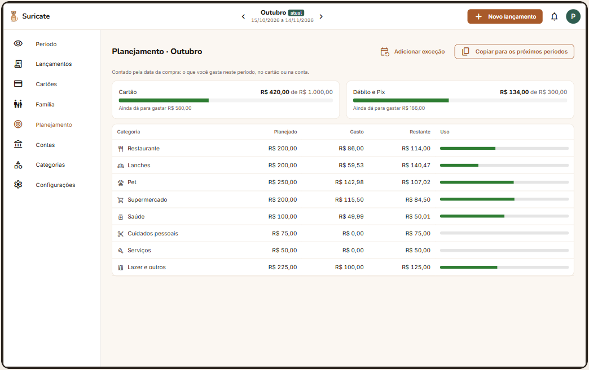 |

As cores das barras indicam a situação: verde até 80% do limite, laranja a partir de 80%, vermelho ao estourar.

### T14 · Categorias

Categorias e subcategorias, com ícone e cor. No celular, cada categoria se expande para mostrar as subcategorias.

### T15 · Detalhe do lançamento

Marcar como pago, marcar "não pode atrasar", mover para outro período, editar e excluir. Excluir pede confirmação na própria tela.

### T16 · Configurações

Regras do período (dia do salário, fim de semana, atraso), refazer qualquer etapa do cadastro guiado e o tema.
