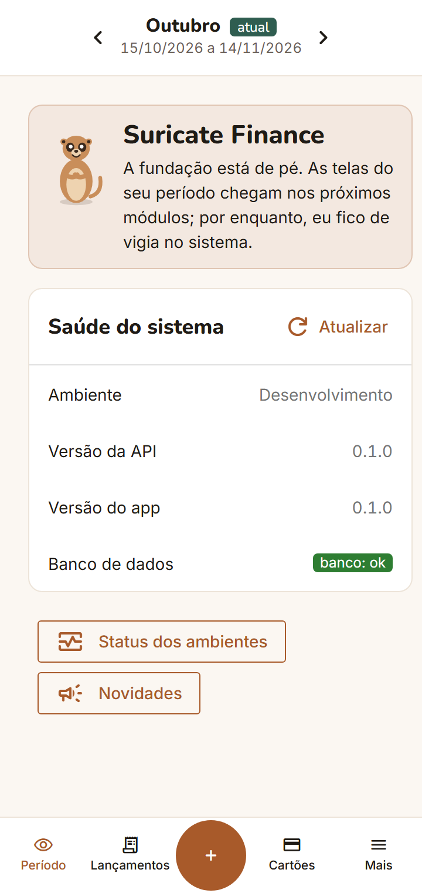
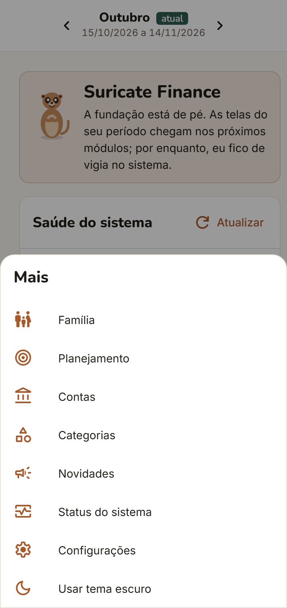
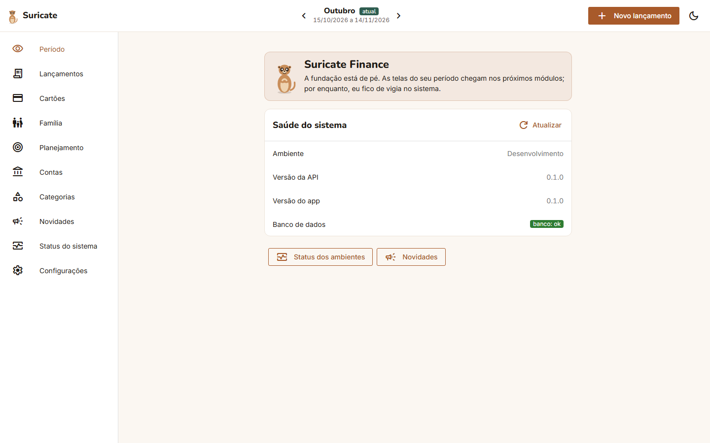
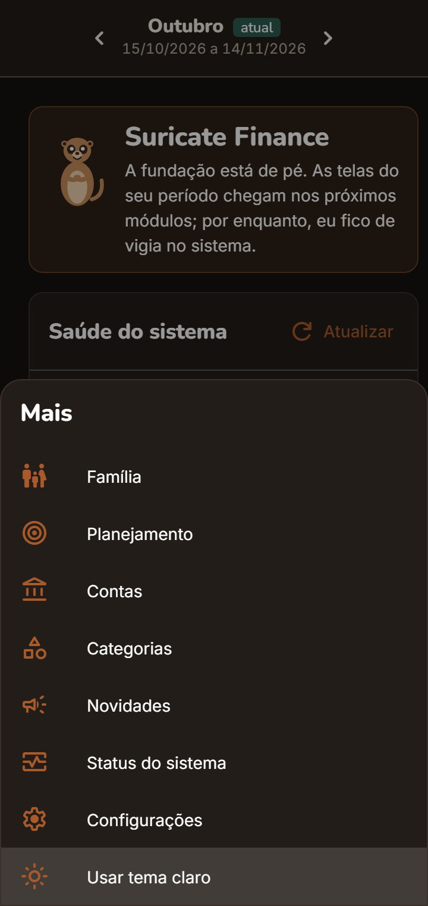
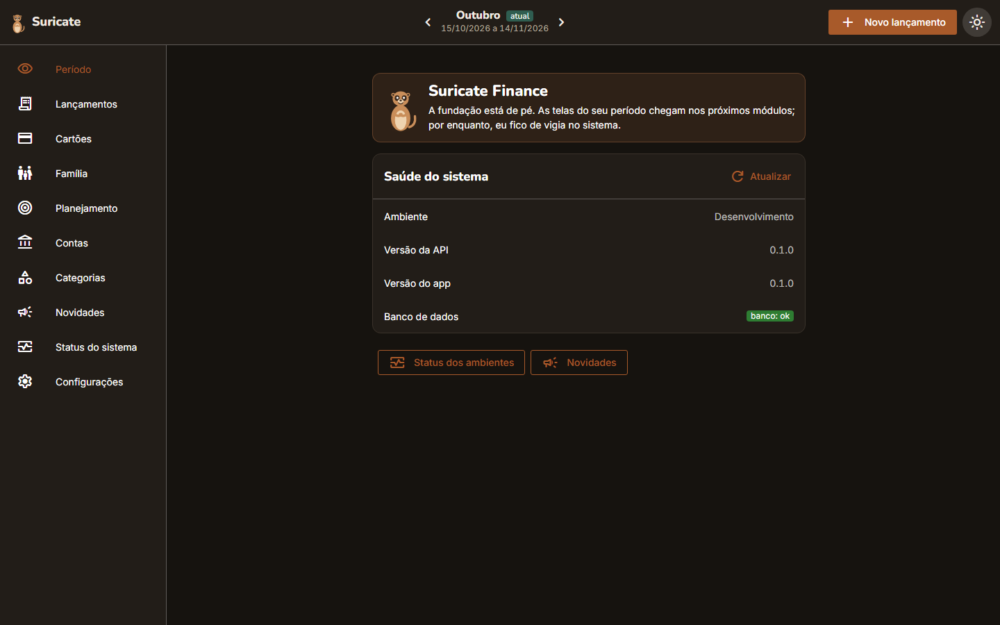
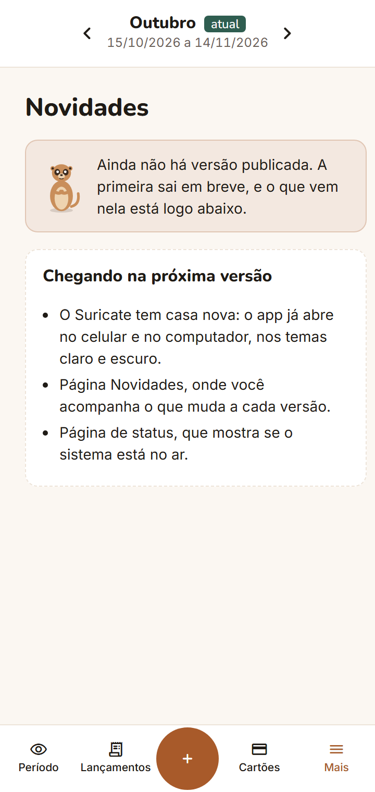
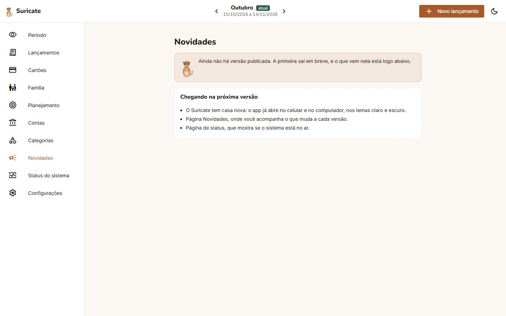
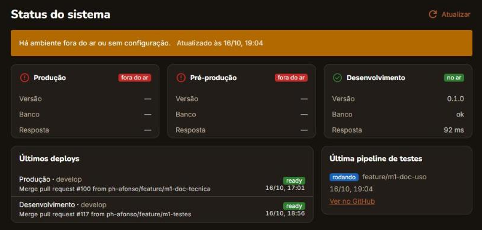
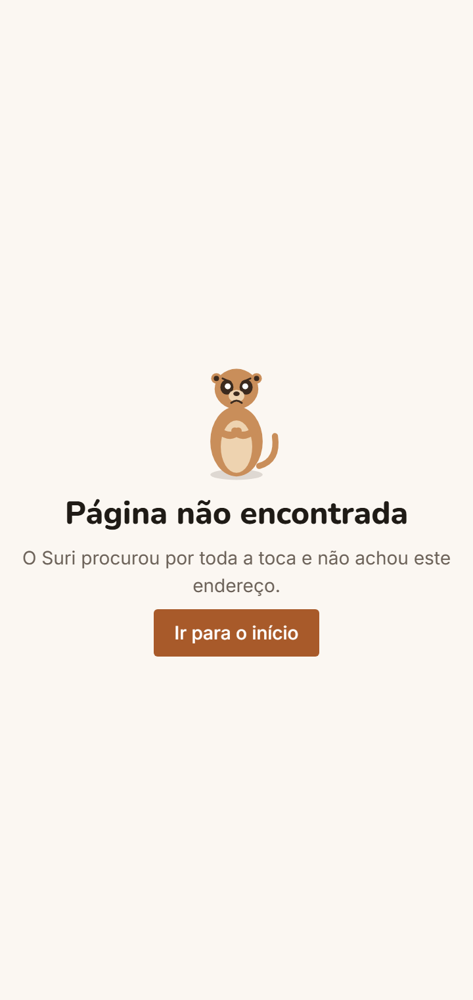

# Guia de uso · M1 Fundação (versão 0.1.0)

O M1 é a casa do Suricate: o app já abre no celular e no computador, tem o menu de navegação, o seletor de período e os temas claro e escuro. As telas de dinheiro (lançamentos, cartões, planejamento) ainda não existem. Cada uma mostra em qual módulo vai chegar.

Este guia mostra o que dá para fazer nesta versão e como cada tela funciona.

## 1. Como abrir

| Ambiente | Endereço | Quem acessa |
| --- | --- | --- |
| Produção | `https://suricatefinance.vercel.app` | Qualquer pessoa, a partir da primeira versão publicada |
| Desenvolvimento | `https://suricatefinance-git-develop-phafonsos-projects.vercel.app` | Só quem entra com a conta da Vercel do projeto |

Até a primeira versão ser publicada, use o endereço de desenvolvimento.

### Instalar como app

O Suricate é um app da web que pode ser instalado. Depois de instalado, ele abre pelo ícone do Suri, em tela cheia, sem a barra do navegador.

| Onde | Como instalar |
| --- | --- |
| Android (Chrome) | Menu **⋮** › **Instalar app** (ou **Adicionar à tela inicial**) |
| iPhone (Safari) | Botão **Compartilhar** › **Adicionar à Tela de Início** |
| Computador (Chrome ou Edge) | Ícone de instalar no fim da barra de endereço |

O app precisa de internet para mostrar os dados. Sem conexão, a tela abre, mas o quadro Saúde do sistema mostra um aviso de erro em vermelho.

## 2. Navegação

### No celular

Os destinos principais ficam na barra inferior. O resto fica em **Mais**.

| Início no celular | Menu "Mais" |
| --- | --- |
|  |  |

- **Período, Lançamentos, Cartões:** atalhos da barra inferior.
- **+ (botão redondo):** cria um lançamento. Nesta versão, ele avisa que os lançamentos chegam no M4.
- **Mais:** abre Família, Planejamento, Contas, Categorias, Novidades, Status do sistema, Configurações e a troca de tema.

### No computador

Todos os destinos ficam na barra lateral, à esquerda. No topo ficam o seletor de período, o botão **Novo lançamento** e o botão de tema (lua ou sol).

## 3. Seletor de período

No topo de todas as telas fica o período. O Suricate organiza o dinheiro pelo **período do salário**, não pelo mês do calendário. Cada período leva o nome do mês em que começa e mostra as datas completas:

> **Outubro** `atual` · 15/10/2026 a 14/11/2026

- As setas **‹** e **›** passam para o período anterior e o seguinte.
- O selo **atual** marca o período em que você está hoje.

Nesta versão, os períodos de setembro, outubro e novembro são só de exemplo. Os períodos de verdade, calculados pelo dia do seu salário, chegam no **M3 · Períodos**.

## 4. Tema claro e escuro

O Suricate segue o tema do seu celular ou computador. Para trocar só no app:

- **Celular:** **Mais** › **Usar tema escuro** (ou **Usar tema claro**).
- **Computador:** botão da lua ou do sol, no canto superior direito.

| Escuro no celular | Escuro no computador |
| --- | --- |
|  |  |

A troca vale até fechar o app. Quando ele abre de novo, volta a seguir o tema do aparelho.

## 5. Página inicial

O Suri explica o momento do app, e o quadro **Saúde do sistema** mostra se está tudo ligado:

| Linha | O que significa |
| --- | --- |
| Ambiente | Produção, Pré-produção ou Desenvolvimento |
| Versão da API / Versão do app | Versão do servidor e da tela; as duas devem ser iguais |
| Banco de dados | **banco: ok** em verde quando o banco responde; em vermelho quando não responde |

O botão **Atualizar** consulta de novo. Os botões de baixo levam ao Status dos ambientes e às Novidades.

## 6. Novidades

Mostra o que mudou em cada versão, da mais nova para a mais antiga, num texto para quem usa, sem termos técnicos. Quando sai uma versão nova, o item **Novidades** do menu ganha um selo. O selo some depois que você abre a página.

| Celular | Computador |
| --- | --- |
|  |  |

Enquanto nenhuma versão foi publicada, a página mostra o que vem na primeira.

## 7. Status do sistema

Uma página pública que mostra se o Suricate está no ar. Ela não mostra nenhum dado de usuário.

| Parte | O que mostra |
| --- | --- |
| Faixa do topo | Verde: todos os ambientes no ar. Laranja: algum ambiente fora do ar ou sem configuração |
| Cartões dos ambientes | Para Produção, Pré-produção e Desenvolvimento: **no ar** em verde ou **fora do ar** em vermelho, a versão, o banco e o tempo de resposta |
| Últimos deploys | A última publicação de cada ambiente, com a mensagem e a hora |
| Última pipeline de testes | Se os testes automáticos da última mudança **passaram**, **falharam** ou estão **rodando**, com link para o GitHub |

A página se atualiza ao abrir. Para consultar de novo, use **Atualizar**.

Hoje, Produção e Pré-produção aparecem fora do ar porque ainda não receberam a primeira versão do app. Isso é esperado e muda na primeira publicação.

## 8. Telas "em breve" e página não encontrada

Os destinos que ainda não foram construídos mostram o Suri e o módulo em que chegam:

| Destino | Chega em |
| --- | --- |
| Lançamentos, Contas, Categorias | M4 · Contas e lançamentos |
| Cartões | M5 · Cartões |
| Família | M6 · Modo família |
| Planejamento | M7 · Planejamento |

Um endereço que não existe mostra a página **Página não encontrada**, com o botão **Ir para o início**.

| Em breve (Cartões) | Página não encontrada |
| --- | --- |
|  |  |

## 9. Perguntas rápidas

**Já posso cadastrar meu salário ou meus gastos?**
Ainda não. O cadastro guiado com o Suri chega no **M2 · Acesso e onboarding**. Os lançamentos chegam no **M4**.

**Meus dados ficam guardados?**
Nesta versão o app não guarda nada seu. O banco tem só um usuário fictício, no ambiente de desenvolvimento, usado nos testes.

**O que faço se a saúde do sistema mostrar banco indisponível?**
Toque em **Atualizar**. O banco gratuito "dorme" quando fica parado e leva alguns segundos para acordar. Se continuar vermelho, abra **Status do sistema** para ver qual ambiente está fora.

---

Para gerar as capturas de novo: `cd e2e && E2E_BASE_URL=http://localhost:9001 node capturas.mjs ../docs/uso/img/m1 /:inicio "/:menu-mais:celular=Mais"`. A captura do Status vem do ambiente de desenvolvimento na Vercel, que tem os três ambientes e os deploys.
