# Guia de uso · M2 Acesso e onboarding (versão 0.1.0)

Com o M2, o Suricate passa a ter dono: cada pessoa cria a própria conta, entra com segurança e conta ao Suri como é a vida financeira dela num **cadastro guiado de 7 etapas**. No fim, o Suri mostra o primeiro período e quanto deve sobrar.

Este guia mostra como criar a conta, entrar, fazer o cadastro guiado, mudar as respostas depois, mandar sugestões e excluir a conta. As telas de dinheiro do dia a dia (o período, os lançamentos, os cartões) chegam do M3 em diante. Tudo o que você cadastrar agora será usado por elas.

> As capturas usam pessoas e valores fictícios.

## 1. Como abrir

Os endereços e a instalação como app são os mesmos do [guia do M1](m1-fundacao.md#1-como-abrir). Até a primeira versão ser publicada, use o endereço de desenvolvimento.

## 2. Criar a conta e entrar

| Entrar (celular) | Criar conta (celular) |
| --- | --- |
|  | 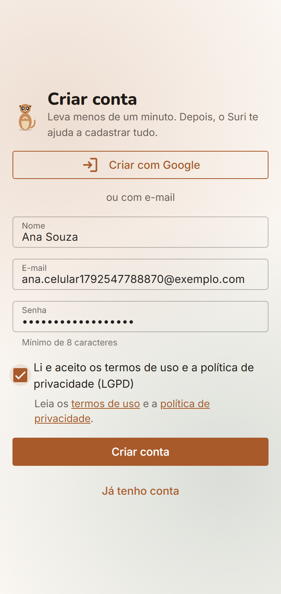 |

### Com e-mail e senha

1. Em **Entrar**, toque em **Ainda não tenho conta**.
2. Preencha nome, e-mail e uma senha com **pelo menos 8 caracteres**.
3. Marque **Li e aceito os termos de uso e a política de privacidade**. Os links logo abaixo abrem os dois textos. O botão **Criar conta** só funciona depois do aceite.
4. Toque em **Criar conta**. O Suri abre o cadastro guiado na etapa 1.

Para entrar de novo, use **Entrar** com o mesmo e-mail e senha. A sessão fica aberta por 30 dias e se renova enquanto você usa o app.

### Com a conta Google

Toque em **Entrar com Google** (ou **Criar com Google**) e escolha a conta. Na primeira vez, o Suri mostra os links dos termos e da política de privacidade e pede **Aceito e continuar**. Se tocar em **Agora não (sair)**, você sai da conta, e o aceite é pedido de novo no próximo login.

Se você já tinha conta com e-mail e senha e entrar com o Google usando o mesmo e-mail, as duas formas passam a abrir a mesma conta.

O botão do Google só funciona nos endereços fixos: produção, pré-produção, `develop` e a máquina local. Nos endereços de teste de cada mudança (previews), entre com e-mail e senha.

### Se errar a senha

A mensagem é sempre **"E-mail ou senha incorretos"**. Ela não diz qual dos dois está errado, para ninguém descobrir quem tem conta. Depois de **5 senhas erradas em 15 minutos**, aquele e-mail fica bloqueado por 15 minutos, mesmo com a senha certa. Espere ou use **Esqueci a senha**.

## 3. Esqueci a senha

1. Em **Entrar**, toque em **Esqueci a senha** e informe o e-mail.
2. A resposta é sempre a mesma: se o e-mail tiver conta, o link foi enviado. Confira também a caixa de spam.
3. O link abre a tela **Senha nova**. Ele vale por **1 hora** e funciona **uma vez só**.
4. Depois de salvar, você já entra no app, e as outras sessões abertas (em outro celular, por exemplo) saem da conta.

Se o link já foi usado ou venceu, a tela avisa e oferece **Pedir outro link**.

## 4. Cadastro guiado

O cadastro guiado tem 7 etapas. Cada etapa concluída dá uma **conquista**, e cada uma pode ser pulada e feita depois.

| Etapa | O que o Suri pergunta | Conquista |
| --- | --- | --- |
| 1. Boas-vindas | Como te chamar e o que você mais quer agora (sair do vermelho, juntar dinheiro, quitar dívida, organizar as contas ou outro) | Primeiro passo |
| 2. Sua renda | Dia do salário, valor médio, o que acontece quando o dia cai no fim de semana, se o salário costuma atrasar e outras entradas fixas | Ponto de partida |
| 3. Contas bancárias | Onde está seu dinheiro hoje: nome, banco, tipo (corrente, poupança, investimentos, VR/VA, dinheiro ou **familiar**) e saldo | Toca do suricato |
| 4. Cartões | Nome, limite, dia em que a fatura fecha e dia em que vence | Vigia do cartão |
| 5. Contas fixas | Contas de todo mês (aluguel, condomínio, água, luz, internet…) e parcelas ou financiamentos em andamento | Nada me escapa |
| 6. Família | Se divide contas com alguém, com quem, a parte da outra pessoa, a conta familiar e quais contas são divididas | Bando unido |
| 7. Objetivos | Suas metas, em ordem, e quanto quer gastar por período no cartão e no débito/Pix | Olhando o horizonte |

### No celular

Uma etapa por tela. No topo aparecem a etapa (ex.: "Etapa 2 de 7"), a seta para voltar e **Pular**, que leva ao início. No rodapé ficam **Pular etapa** e **Continuar**.

| 1. Boas-vindas | 2. Sua renda | 3. Contas bancárias |
| --- | --- | --- |
| 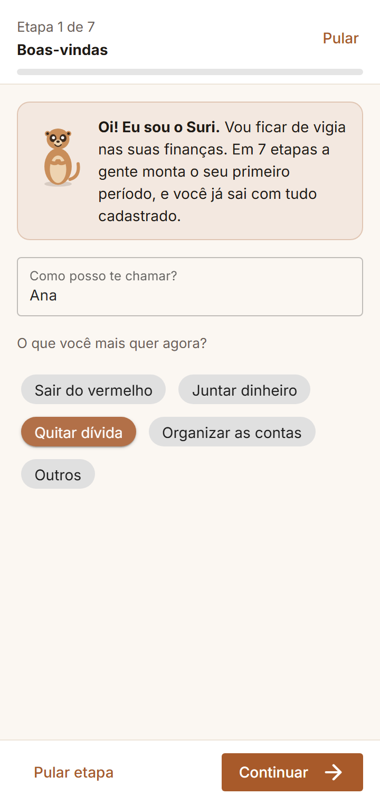 | 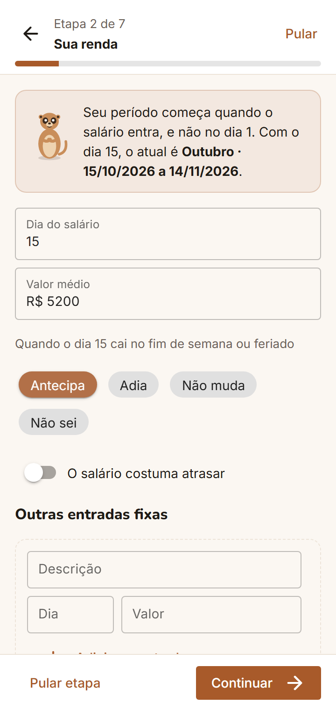 | 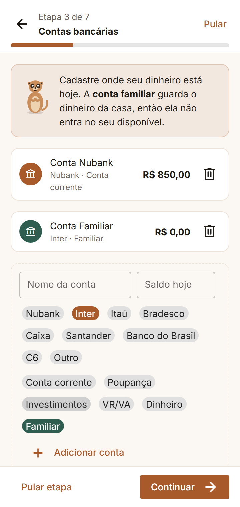 |

| 4. Cartões | 6. Família | 7. Objetivos |
| --- | --- | --- |
| 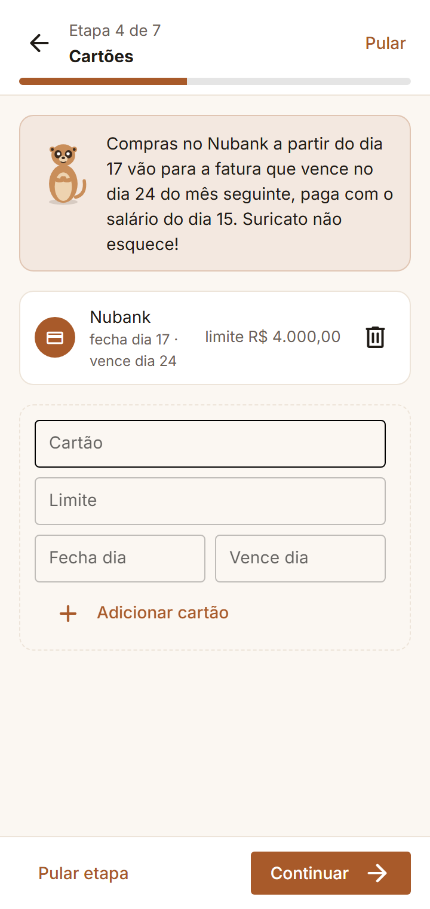 | 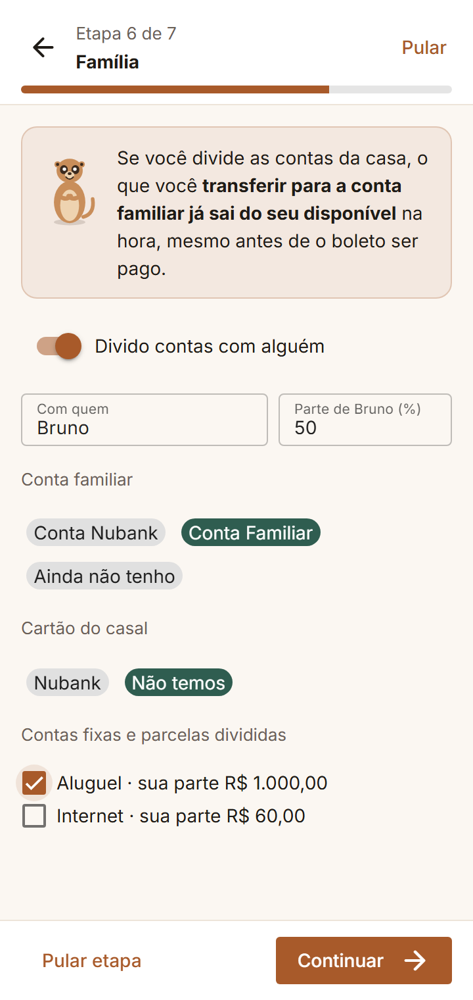 | 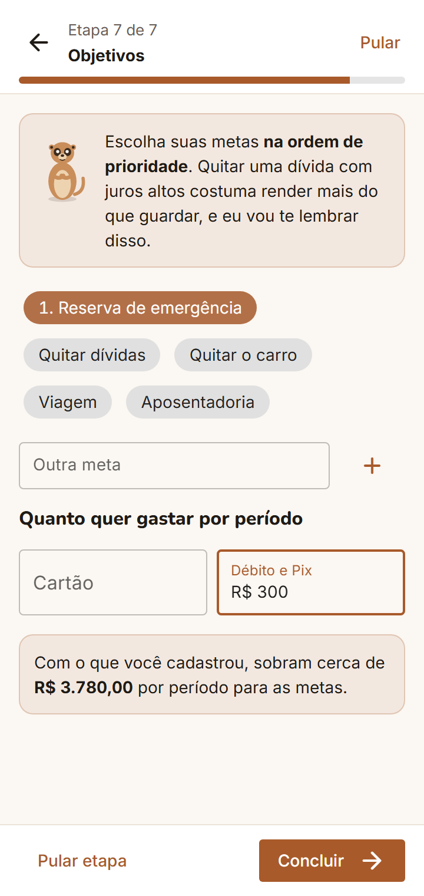 |

Ao tocar em **Continuar**, o Suri confere as respostas, salva a etapa e mostra a conquista no topo:

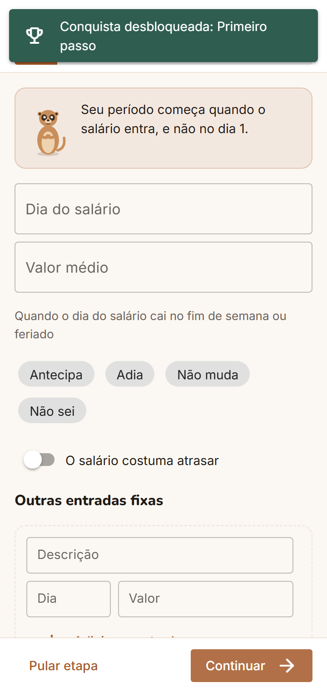

### No computador

As etapas ficam à esquerda, com um ✓ nas concluídas e a barra de conquistas. Dá para clicar em qualquer etapa. À direita, a **prévia do período** se atualiza enquanto você preenche.

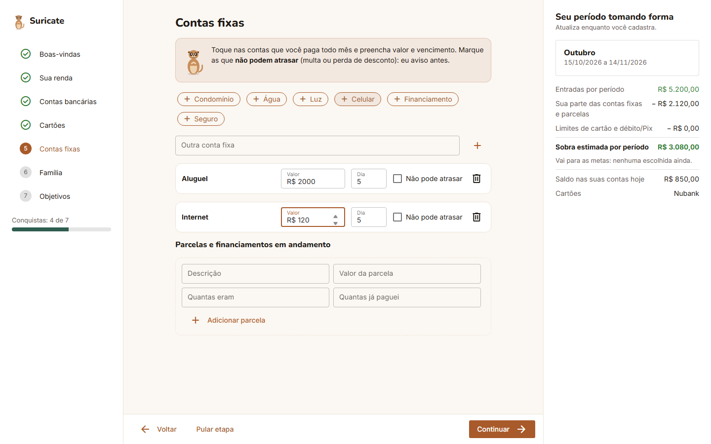

| Linha da prévia | De onde vem |
| --- | --- |
| Nome e datas do período | Do dia do salário (ex.: salário dia 15 → "Outubro · 15/10/2026 a 14/11/2026") |
| Entradas por período | Salário + outras entradas fixas |
| Sua parte das contas fixas e parcelas | Contas fixas e parcelas em andamento; nas divididas, só a sua parte |
| Limites de cartão e débito/Pix | Os limites da etapa Objetivos |
| **Sobra estimada por período** | Entradas − sua parte das contas − limites |
| Saldo nas suas contas hoje | Soma dos saldos da etapa 3, **sem** a conta familiar |

Nesta versão, o período ainda não muda quando o dia do salário cai no fim de semana. Esse ajuste chega no **M3 · Períodos**.

### Dicas por etapa

- **Opções em chips:** toque para escolher; a escolhida fica colorida. **Outros** abre um campo para escrever, e **Não sei** aparece em toda pergunta de múltipla escolha. Na renda, "Não sei" conta como "não muda", e o Suri avisa.
- **Contas fixas:** os chips (Aluguel, Condomínio, Água…) já entram na lista com um toque. Depois, ajuste o valor e o dia. Marque **Não pode atrasar** nas contas que têm multa ou perdem desconto. Em parcelas, informe quantas eram e quantas já pagou, e o Suri mostra quantas faltam.
- **Cartões:** depois de adicionar, o Suri explica em que fatura cai cada compra (ex.: "Compras no Nubank a partir do dia 17 vão para a fatura que vence no dia 24 do mês seguinte").
- **Família:** o que você transfere para a conta familiar sai do seu disponível na hora, mesmo antes de o boleto ser pago. Em cada conta dividida, o Suri mostra a sua parte.

### Fechamento

Depois da etapa 7, o Suri comemora e mostra o primeiro período, os totais (contas, cartões, contas fixas e sobra estimada) e as conquistas. **Ver meu período** leva ao início.

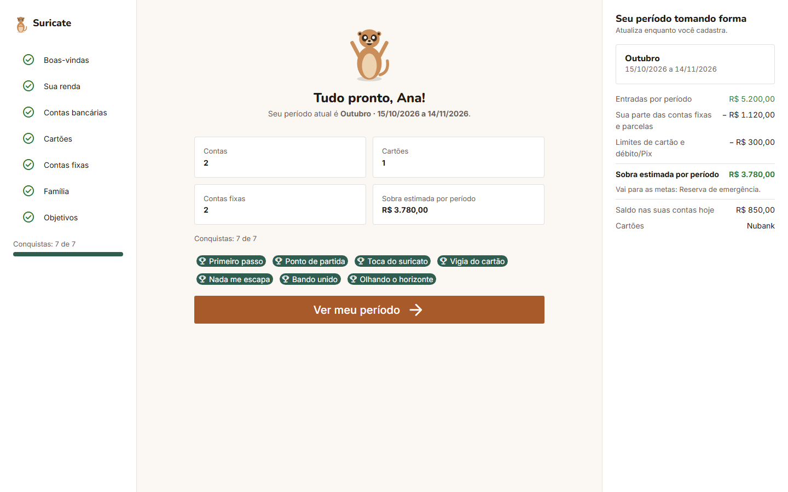

## 5. Parou no meio? Retomar e refazer

**Retomar:** o cadastro guarda cada etapa assim que você toca em **Continuar**. Se fechar o app, ao abrir de novo ele volta na etapa onde você parou. Se tocar em **Pular** no topo, o início mostra um cartão para continuar depois:

| Início com o cadastro pela metade | Início com o cadastro completo |
| --- | --- |
| 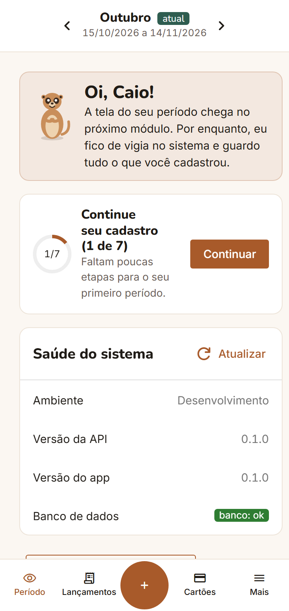 | 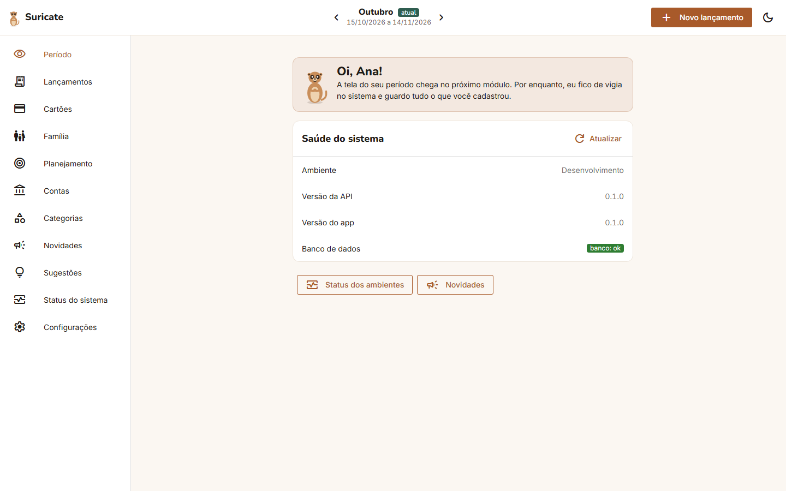 |

**Refazer:** em **Configurações › Cadastro guiado**, cada etapa aparece com o status (**Concluída**, **Pulada** ou **Não feita**) e o botão **Refazer** ou **Fazer**. A etapa abre com as respostas atuais. Ao salvar, as respostas novas substituem as antigas, e a conquista já ganha continua com você.

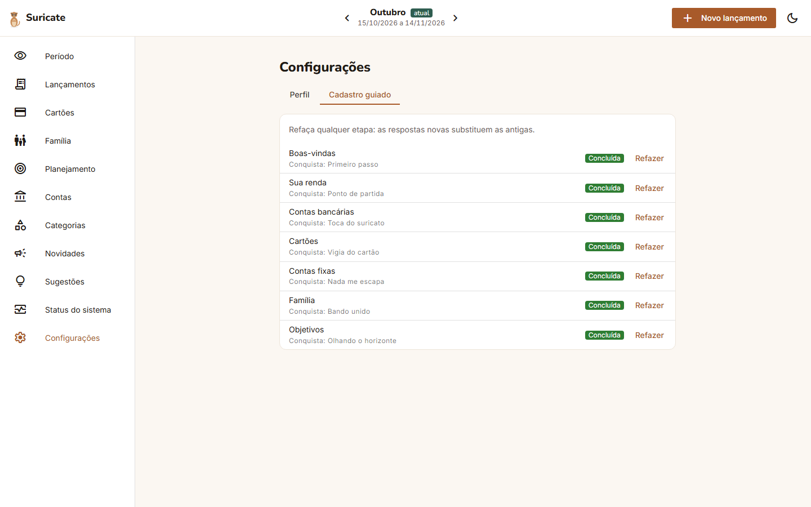

## 6. Configurações › Perfil

No celular, fica em **Mais › Configurações**. No computador, na barra lateral.

| Perfil | Excluir a conta |
| --- | --- |
| 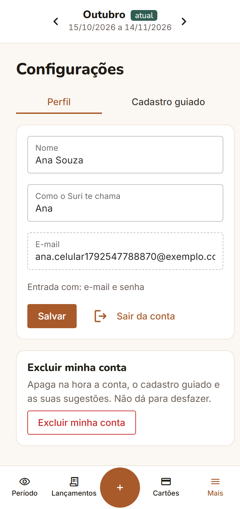 | 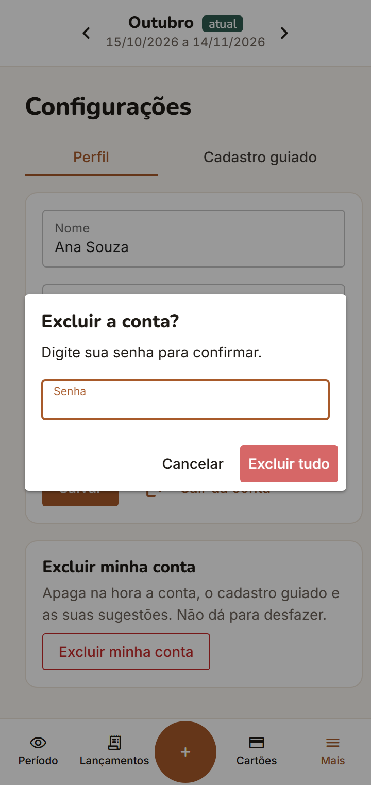 |

- **Nome** e **Como o Suri te chama:** edite e toque em **Salvar**.
- **E-mail:** só leitura. A linha "Entrada com" mostra se a conta usa e-mail e senha, Google ou os dois.
- **Sair da conta:** encerra a sessão neste aparelho.
- **Excluir minha conta:** apaga **na hora e sem volta** a conta, o cadastro guiado e as suas sugestões. Para confirmar, digite a sua senha. Se a conta só usa o Google, digite **EXCLUIR**.

## 7. Sugestões

Teve uma ideia ou achou um problema? No celular, abra **Mais › Sugestões**. No computador, use a barra lateral.

| Menu "Mais" | Nova sugestão |
| --- | --- |
| 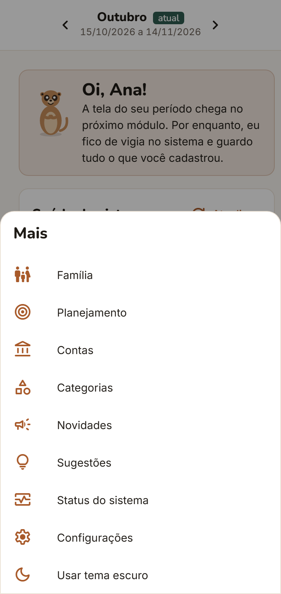 | 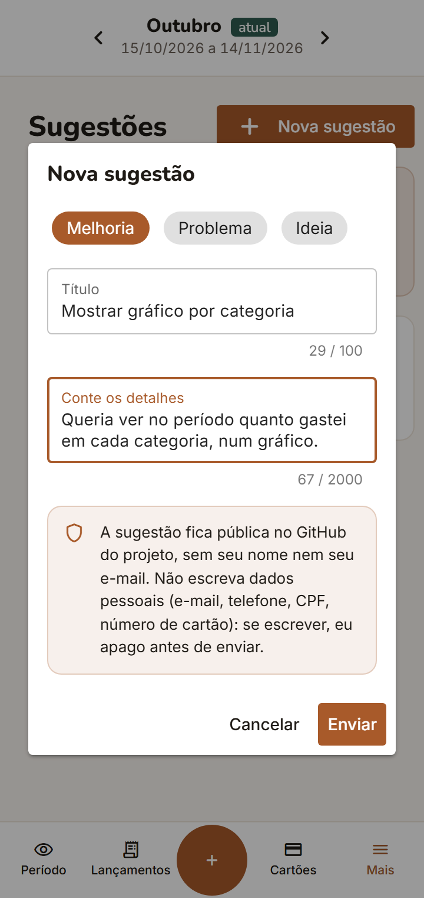 |

1. Toque em **Nova sugestão** e escolha o tipo: **Melhoria**, **Problema** ou **Ideia**.
2. Dê um título e conte os detalhes (pelo menos 10 letras). A tela em que você estava vai junto, sem precisar escrever.
3. Toque em **Enviar**. O Suri mostra o código da sugestão, por exemplo **S-7F3K**.

A sugestão fica **pública** no GitHub do projeto, **sem o seu nome nem o seu e-mail**. Se você escrever e-mail, telefone, CPF ou número de cartão, o Suri apaga esses dados antes de enviar. Dá para mandar até **5 sugestões por dia**.

Na lista **Minhas sugestões**, cada uma mostra o andamento:

| Status | O que significa |
| --- | --- |
| Recebida | Chegou e está esperando a análise |
| Planejada | Vai ser feita; já está num módulo ou versão |
| Entregue | Já está no app. Confira em Novidades |
| Não será feita | Foi analisada e ficou de fora |

## 8. Termos de uso e privacidade

Os textos ficam em `/termos` e `/privacidade` e abrem mesmo sem entrar na conta. Cada um mostra a versão do texto. Nesta versão, eles são um **rascunho em revisão**, e o texto final passa por revisão jurídica antes de o app abrir para outras pessoas.

## 9. Perguntas rápidas

**Outra pessoa pode ver os meus dados?**
Não. Cada conta só enxerga o que é dela. Se alguém tentar abrir um dado de outra pessoa, o app responde como se ele não existisse.

**O Suricate guarda a minha senha?**
Não guarda a senha em si. Guarda só uma "impressão digital" dela (um *hash*), que não dá para transformar de volta em senha.

**Já vejo o meu período e os meus gastos?**
Ainda não. O cadastro guiado prepara tudo. O período chega no **M3**, e as contas e os lançamentos, no **M4**. As respostas do cadastro serão levadas para essas telas.

**Errei uma resposta. Preciso começar de novo?**
Não. No computador, clique na etapa à esquerda. Depois do fechamento, use **Configurações › Cadastro guiado › Refazer**.

**O e-mail de "esqueci a senha" não chegou.**
Confira o spam e espere alguns minutos. Se não chegar, peça de novo. Se você criou a conta com o Google, também pode entrar direto com o Google.

**Divido as contas com outra pessoa. Ela precisa ter conta?**
Não nesta versão. Você informa a parte dela na etapa Família. Perfis para a família inteira, com a pessoa usando o próprio login, estão planejados para uma fase futura.

---

Para gerar as capturas de novo, com a API e o app ligados na máquina (porta 9001): `cd e2e && node capturas-m2.mjs`. O script cria contas fictícias, percorre o cadastro guiado no celular e no computador e salva as imagens em `docs/uso/img/m2`.
